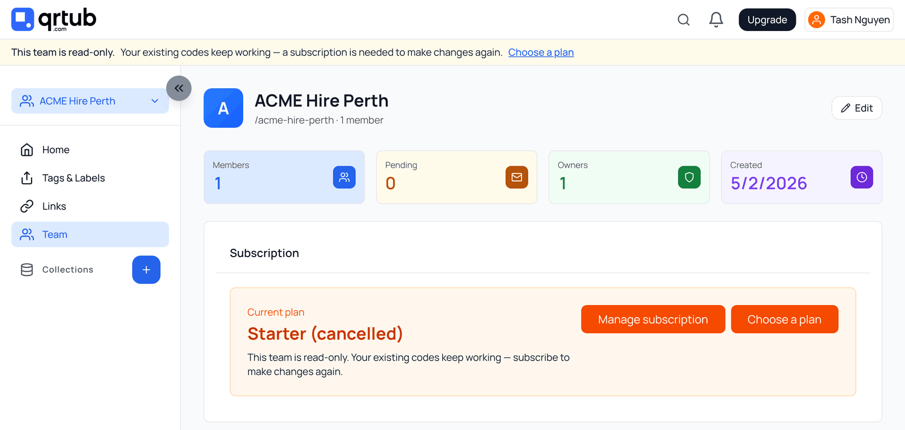

Every team with a subscription carries a status that QRtub receives from Stripe and stores against that team. It is the answer to "is this team's payment in good order right now". Alongside it QRtub keeps the plan name, the end of the current billing period, and whether a cancellation or plan change is scheduled (see [Managing Your Subscription](/billing/customer-portal)).

## What each status means

`active`, `trialing` and `past_due` count as paying: the team works normally. Every other status makes the team read-only (see below).

| Status | What it means | What the Subscription card shows |
|--------|---------------|-----------------------|
| `active` | Paid and current. | The plan name. |
| `trialing` | Inside a trial period. QRtub does not sell trials, so you would not normally see this. | The plan name. |
| `past_due` | An invoice failed and Stripe is retrying it. | The plan name, with no warning of any kind. |
| `unpaid` | Stripe's retries ran out without a payment. | The plan name followed by `(payment failed)`, and advice to update your card in the billing portal. |
| `incomplete` | The first payment was never confirmed. | `(payment incomplete)`, and advice to get in touch for a new checkout. |
| `incomplete_expired` | The first payment was not completed in time, so the subscription never started. | `(payment expired)`, and advice to choose a plan to try again. |
| `paused` | The subscription is paused. | `(paused)`, and advice to get in touch to resume it. |
| `canceled` | The subscription has ended. | `(cancelled)`, and "subscribe to make changes again." |

Each of the read-only states also says "Your existing codes keep working".

## Where it shows

Two places, both for the team owner only:

- **The team page**, under **Subscription** — the plan name with any of the labels above, or **No active subscription** if the team has never been subscribed.
- **Profile → Your teams & subscriptions** — one row per team you own, with a badge using the same words: green for a subscription in good order (and for **Complimentary access**), amber for any of the read-only states, gray for a team with no subscription.

A team that QRtub has given free access by hand shows **Complimentary access** instead of a plan name, with the date the access ends if it has one.

## A failed payment is quiet inside QRtub

This is the one to plan around. When a payment fails, Stripe emails you and starts retrying, and QRtub records the team as `past_due` — but the team page still shows the plan name with no banner, no color change, and no notification. Nothing in the app tells you a card has bounced.

So a failed payment reaches you through Stripe's email, not through QRtub, until Stripe gives up: then the status becomes `unpaid`, the card says `(payment failed)` and the team is read-only. Make sure the address on the subscription is one somebody actually reads, and if you suspect a card has expired, open the billing portal and check rather than waiting for a warning in the app. [Managing Your Subscription](/billing/customer-portal) covers how to get there.

## Status changes arrive when Stripe reports them

QRtub does not poll Stripe. It updates a team's status when Stripe notifies it of a change — normally within a few seconds of the event. That means a payment you have just made, or a change you have just made in the billing portal, can take a moment to appear on the team page. Reload the page rather than repeating the action.

## A team without an active subscription is read-only

When a team's status is anything other than `active`, `trialing` or `past_due`, or it has never been subscribed, nobody on it can create or edit Collections, Items, Links or Pages, change a Print Batch, or invite anyone. Its Links keep resolving, so codes already out in the world keep working, and you can still view and export everything, including production lists (each export still records its Print Batch). Membership stays open too: accepting an invitation, leaving, removing a member and revoking an invitation all still work.

Every member sees a banner across the top of the app: **This team is read-only.** for a team that had a subscription, or **This team is not active yet.** for one that never did. The owner gets a **Choose a plan** link in it; other members are told "Ask the team owner to set one up."

For the owner, the **Upgrade** button also appears in the top bar. For a team that was never subscribed, or whose subscription is `canceled` or `incomplete_expired`, it opens the plan picker; for `unpaid`, `incomplete` or `paused` it opens the billing portal instead, because that subscription can still be brought back. A new subscription, or a recovered one, makes the team editable again as soon as Stripe reports it.

## Related

- [Managing Your Subscription](/billing/customer-portal) — fixing a payment method, invoices, canceling
- [Plan Limits & Quotas](/billing/plan-limits) — what your plan includes
- [Billing Is Per-Team](/billing/per-team-billing) — why each team has its own status
- [Upgrading a Team's Plan](/billing/upgrade-a-team) — putting a plan on a team that has none
