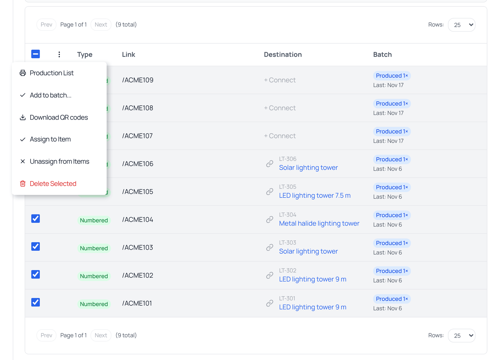

Select Links in the list, then open the **⋮** menu in the list's header row. It holds **Production List**, **Add to batch...**, **Download QR codes**, **Assign to Item**, **Unassign from Items** and **Delete Selected**, plus **Remove from active batch** while the list is filtered to one batch. This page covers assigning, unassigning and deleting. Changing a destination or fallbacks is a per-Link edit, or a job for the CSV import.

## Two ways to select, and the difference matters

**Ticking rows** operates on exactly the Links you ticked, including ones you ticked on other pages of the list.

**Select all** — the checkbox at the top of the list — is different: it selects every Link matching your current view, not just the page in front of you. While you have not unticked anything and no search or batch filter is applied, QRtub sends the *filters* rather than a list of IDs, and resolves them on the server, so "delete all 4,000 unassigned random Links" is one request instead of shipping 4,000 IDs out to your browser and back. Otherwise it collects the IDs of every matching Link first and sends those. Either way, the count in the confirmation dialog is the full total, so read it before confirming — that is your check that the scope is what you meant.

The selection follows what the list shows: link type, the **Allocated** or **Unallocated** card, any column filters (a **Batch** filter included), and your search term. Untick a row after selecting all, and every other match stays selected (the header checkbox shows a dash). Change a filter, the sort, the search or the team, and the selection is cleared.

## Assigning many Links to an Item

**Assign to Item** opens a picker covering every Item in the team, across all Collections, and points every selected Link at the one Item you choose.

That is the right shape more often than it sounds — a machine that carries a plate on the cab, a sticker in the engine bay and a spare tag in the office is one Item with three Links. But it does mean bulk assign cannot pair a list of Links with a list of Items one-to-one; that is a per-Link action, or a job for the Collection's link generation setting.

A Link points at no more than one Item, so assigning replaces any existing assignment without asking.

## Unassigning many Links

**Unassign from Items** detaches every selected Link and returns it to the unassigned pool. The Links stay alive and the codes already on Tags keep resolving — a scan lands on the neutral "not connected yet" page instead of the Item's Page, or on a Link's own destination URL if it still has one from before it was assigned.

There is no print-status restriction on this. Detaching a code that is already installed is a normal, expected thing to do when the equipment behind it changes.

## Deleting many Links

**Delete Selected** is permanent and there is no undo — the slugs stop resolving and anyone scanning those codes gets "Page not found". QRtub asks for confirmation with the count first.

The important rule is that a bulk delete is **all or nothing**. Before deleting anything, QRtub checks whether any Link in the selection belongs to a print batch that has moved past Draft. If even one does, the whole operation is rejected and nothing is deleted. You never end up with a partially deleted selection and no clear record of which rows went.

That check makes a large bulk delete a slightly awkward instrument: one code in a batch past Draft in a selection of two thousand blocks the lot. Narrow the selection, step the batch back to Draft if it never reached a Supplier, or unassign rather than delete.

## Working at real scale

- Bulk actions run in chunks behind the scenes, so thousands of Links at once is a supported size rather than a stress test
- Selection resets after each action completes, and the list refreshes
- When QRtub refuses an operation, such as a delete blocked by a print batch, it refuses before changing anything, with a message

## Related

- [Deleting, Unassigning, and Releasing Links](/links/deleting-and-releasing-links) — the three outcomes in detail, including automatic release
- [Downloading QR Codes](/bulk-links/downloading-qr-codes) — the **Download QR codes** action
- [Bulk Link Import via CSV](/bulk-links/csv-import) — bulk *editing* of destinations and fallbacks
- [Adding and Removing Links in a Batch](/print-batches/editing-links) — batch membership, behind **Add to batch...** and **Remove from active batch**
