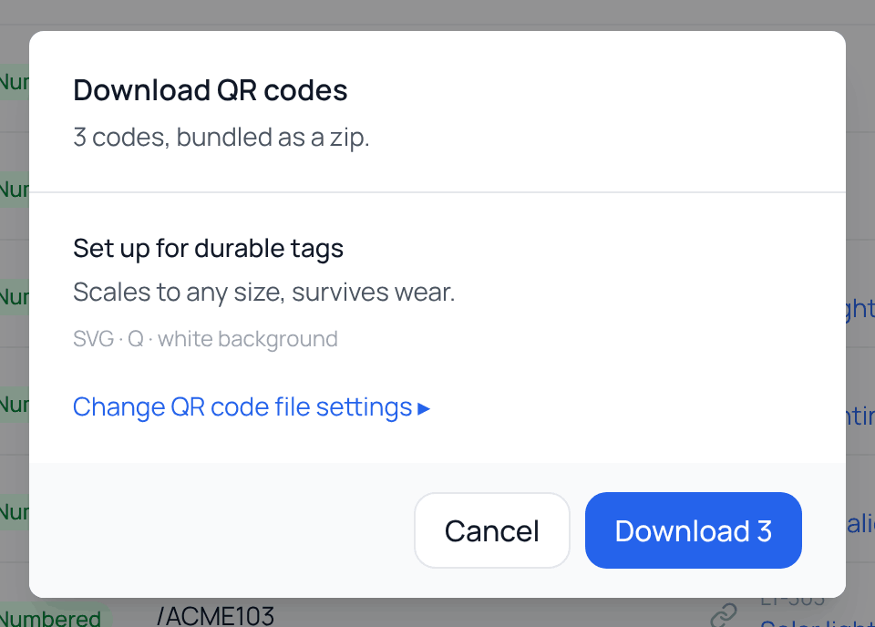
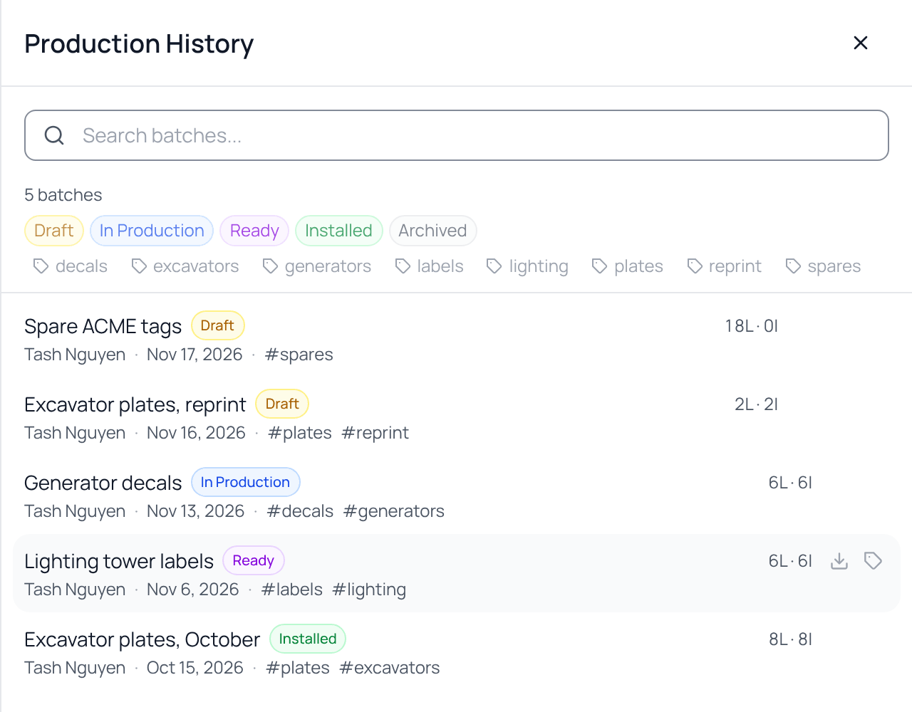
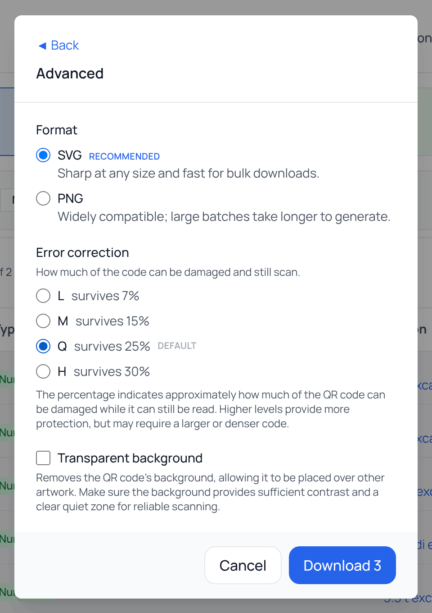

QRtub generates QR code images from your Links on demand. One Link gives you a dialog showing the
code; several give you a ZIP.

The defaults are chosen for a Tag that has to last, so most exports need nothing changed. Everything
adjustable sits behind **Change QR code file settings**, which opens the **Advanced** view. For what
each setting does and when to deviate, see [QR Code Standards](/suppliers/qr-code-standards).

## One code

Open a Link's row menu and choose **Download QR code**. You get a dialog titled **QR code** with the
Link's slug, its full address with a **Copy URL** button beside it, the code itself, and a summary
of the file settings, such as `SVG · Q · white background`. **Download** saves the file; **Close**
leaves without one.

Scan it straight off the screen to check where the Link goes — usually faster than downloading a
file to look at it.

The address shown is exactly what the code encodes, scheme included: `https://qrtub.com/bar002` for
a numbered or custom Link, `https://qrtub.com/bepjov` for a random one — not the slug on its own.
So what you copy and what someone scans are the same string, and Download gives you a file named
after the slug, like `qr-code-bar002.svg`.

## Downloading many at once

Select the Links you want and choose **Download QR codes** from the **⋮** menu in the list's header
row. The dialog shows how many codes are about to be produced. With more than one selected you
always get a ZIP named for the date (in UTC), like `qr-codes-2026-09-02.zip`, containing one file per
Link named the same way as a single download. Every file sits at the top level of the ZIP; if an
older Link's name contains a slash, its file uses an underscore instead, and if two files would end
up with the same name, the later one gets `-2`, `-3` added. There is no option to receive many
separate files instead. (Tick just one Link and you get a single file, not a ZIP.)

The **Production List** dialog on the Links page has a **QR codes** button too: it closes that
dialog and opens this one for the same selection.

A Batch has its own download button: open the **Production History** panel on the Links page
and hover the batch's row to show its tag icon, whose tooltip reads "Download this batch's QR
codes". It opens the same dialog, and the ZIP holds every Link in the batch at that moment, named
after the batch, like `Excavator-plates-qr-codes.zip`.

Because the filenames carry the slug, they line up with the **Link** and **Short URL** columns of an
exported production list — which is how a supplier matches each image to its data row. Neither
column is a byte-for-byte match for the filename, though: **Short URL** adds a leading slash, and
**Link** adds the protocol and domain. Whoever does the matching has to strip those.

The images are generated in your browser. SVG is close to instant, even for thousands of codes. PNG
is much slower: it is generated fifty at a time, and a PNG download of more than 150 codes shows a
progress toast counting up as it goes, then a packaging step. Either way the tab has to stay open
until the file arrives — if you close it, you get nothing and have to start again. If you used
"select all", QRtub fetches the full matching set of Links first, so the total you see counts every
match, not just the page on screen.

## What you can change

The dialog opens with no settings showing — it states what you are about to get, and everything sits
behind **Change QR code file settings**. The defaults suit a durable Tag, so most exports need
nothing touched.

**Format — SVG or PNG.** SVG is the default: sharp at any size and fast for bulk downloads. Choose
PNG when the software receiving it does not support SVG — Google Docs and Slides, most email
clients, and a lot of label-printer software. Large PNG batches take longer to generate.

**Error correction — L, M, Q or H.** The percentage is roughly how much of the code can be damaged
while it can still be read: 7%, 15%, 25% and 30%. **Q is the default**, and right for anything
produced as a physical Tag. Higher levels give more protection but may require a larger or denser
code. See [QR Code Standards](/suppliers/qr-code-standards).

**Transparent background.** Off by default, and not offered in the one-Link dialog, which always
exports a white background. It removes the code's background so it can sit
over other artwork — only take it when you control what ends up behind the code, because the white
background is what guarantees the quiet zone.

## What you cannot change

Worth being explicit about, because most QR generators expose these:

- **PNG size is fixed** at 1024 × 1024 pixels. Not adjustable — but SVG makes it mostly moot, since
  vector art has no fixed size.
- **Colors are fixed** at black on white, apart from turning the background off.
- **The quiet zone is fixed** at 4 modules, which is what print specifications ask for. It is not a
  setting because there is no good reason to reduce it.
- **Codes in one batch are not forced to a common size.** Addresses differ in length, so a batch can
  contain codes of different module counts. Cut to one Tag size, the denser ones have smaller
  modules. If that matters for a run, keep the addresses in it a consistent length.
- **Nothing is added to the image.** No logo, no caption, no border, no slug printed underneath.
  Whatever surrounds the code is your layout's job — and a logo belongs beside the code rather than
  inside it, for reasons covered in [QR Code Standards](/suppliers/qr-code-standards).

## Related

- [QR Code Standards](/suppliers/qr-code-standards) — which format and error-correction level to choose
- [Bulk Assigning, Unassigning, and Deleting Links](/bulk-links/assign-unassign-delete) — how selection and "select all" work
- [Quiet Zone and Minimum Size](/suppliers/quiet-zone-and-size) — the clear space and minimum size a printed code needs
- [Matching QR Codes to Data Rows](/suppliers/matching-codes-to-rows) — how these filenames pair each image with its CSV row
