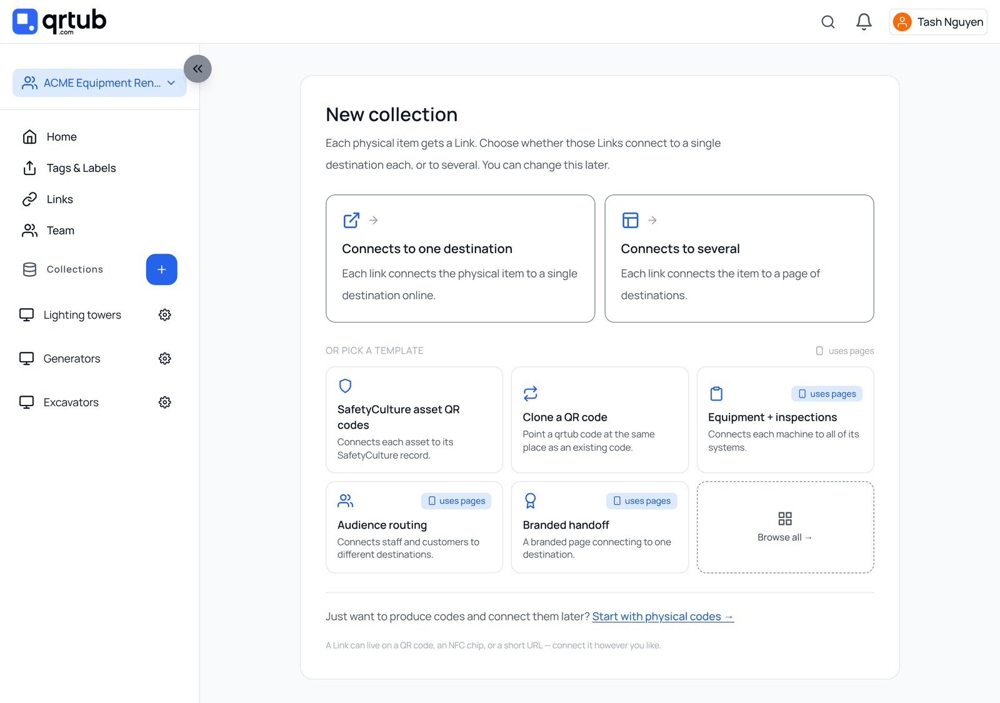
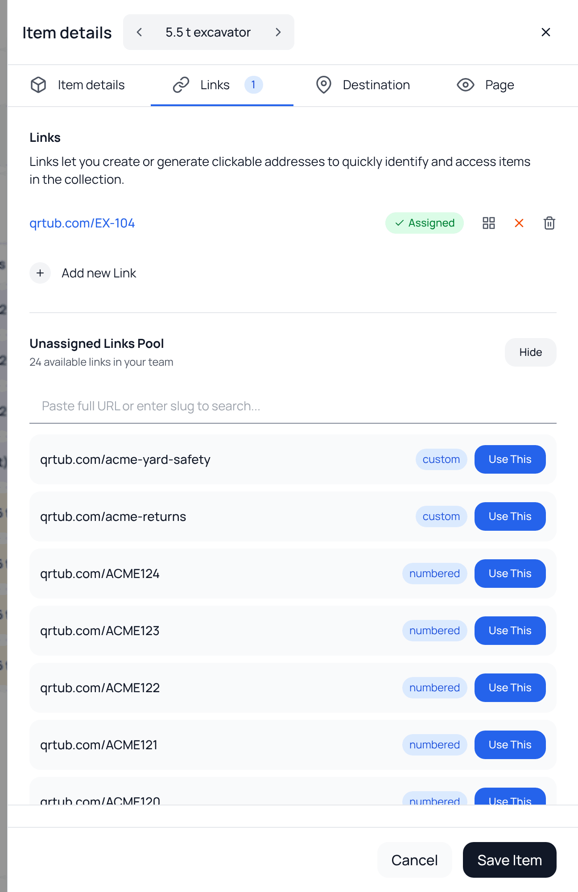
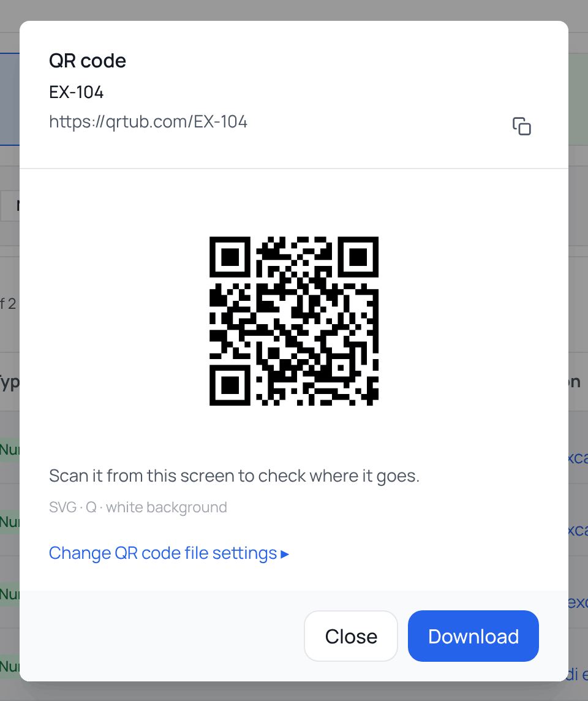

This walks one complete path from an empty account to a QR code you can print and scan. It is
not the only order that works — Links do not depend on Collections, Items or Pages, so
creating a hundred Links first and connecting them months later is equally valid.

**Before you start:** you need a QRtub account and a team selected in the team switcher at the
top of the sidebar. The team needs a subscription: until it has one, the app shows **This team
is not active yet** and nothing can be created.

## Create a Collection

In the sidebar, click the **+** next to **Collections**. The **New collection** screen it opens
offers two cards — *Connects to one destination* and *Connects to several* — plus a row of
starter templates.

Picking any of them creates the Collection immediately. There is no form: the Collection gets
an automatic sequential name (`Collection1`, `Collection2`, and so on) and you land on its grid,
empty if you picked a card and holding three sample Items if you picked a template. Click the
name to rename it; the description and image are in the Collection's settings. The two cards
set what a scanned code does by default — pass through to one destination, or open a Page
listing several — and that is changeable later in settings.

## Add an Item and get a Link

Click **Add your first item**, give it a name, and save. Collections created this way default
to random link generation, so QRtub mints a Link at the moment the Item is saved and confirms
it with a message naming the new slug.

To see it, open the Item and switch to its **Links** tab — the full URL is listed there,
in the form `qrtub.com/bepjov`. An Item can hold more than one Link.

If a Collection is set to **Don't create a link** — the default for older Collections — saving
an Item mints no Link, and you attach one yourself as below.

## Or start from a Link you already printed

Open **Links** in the sidebar and click **Create Link**. Choose a strategy — Random,
Numbered, or Custom — and for Random, set **Number of Links** to create up to 1,000 at a time. Nothing needs to
exist first: a Link with no Item and no destination is a valid, permanent, printable
Link.

To connect one, use the row menu on any Link and choose **Assign to Item**; the picker searches
the whole team, so the Item can live in any Collection. An Item's **Links** tab works from the
other direction: its **Unassigned Links Pool** lists the team's unassigned Links so you can
attach a code produced in advance there.

## Download the QR code

From a Link's row menu, choose **Download QR code**. The dialog shows a live preview you can scan
straight off the screen, and **Download** saves a single SVG named after the slug, like
`qr-code-bepjov.svg`: black on white, a 4-module quiet zone, error correction level Q.
**Change QR code file settings** switches to PNG (1024 px) or another error-correction level.
To get several at once, tick them and choose **Download QR codes** from the **⋮** menu in the
list's header row; they arrive as one zip. See [Downloading QR Codes](/bulk-links/downloading-qr-codes).

## Point the Link at something

Open the Item and use the **Destination** tab to set where a scan goes, or the **Page** tab to
build a screen with several Destinations. Either can be changed at any time without
touching the printed code.

A Destination can be a fixed URL or a template that inserts this Item's own field values, so
one template serves every Item in the Collection. Values are inserted exactly as stored — no
URL-encoding — so a field containing an `&` or a `#` breaks the resulting link, and a space can too.

## Related

- [What a Link Is](/links/what-a-link-is) — the slug-to-destination model
- [Choosing a Link Type](/links/choosing-a-link-type) — random vs. numbered vs. custom
- [Field Bindings & URL Templates](/destinations/field-bindings) — the `{{ }}` syntax and its rules
- [The Print-First Workflow](/print-first/overview) — printing in bulk before the Items exist
