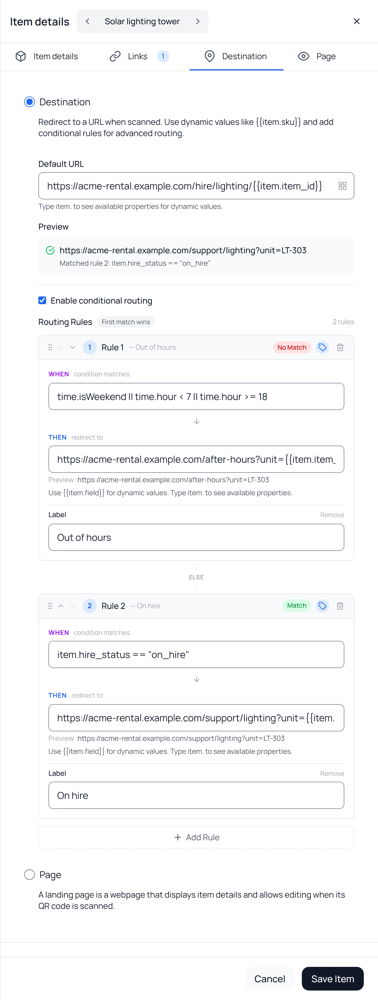

Conditional Destinations are an ordered list of rules on one Item, each pairing a condition with a URL. At scan time QRtub walks the list from the top; the first rule whose condition is true **and** whose URL fully resolves is where the visitor goes. If no rule produces a usable URL, the scan falls back to the Item's plain Default URL.

This is a routing decision — which of several URLs a single code opens. It is not [Conditional Visibility](/destinations/conditional-visibility), which shows or hides one section on a Page. Routing rules decide the redirect itself, so they work even when there is no Page at all.

## Where you set the rules

Open the Item, go to its **Destination** tab, and select **Destination**. Below the **Default URL** field is a checkbox labeled **Enable conditional routing**. Checking it reveals a **Routing Rules** list, badged **First match wins**.



**Known issue: the first rules on an Item are not saved.** On an Item that has no routing rules yet, rules you add here are dropped when you click **Save Item**, with no error: the editor and its preview still show them, but after a reload **Enable conditional routing** is unticked and scans use the Default URL. Rules an Item already has can be edited and saved normally. After saving, reload the Item to check its rules are still there.

Each rule is a numbered card (Rule 1, Rule 2, …) with two fields:

- **When** — a CEL condition, such as `item.status == "active"`. Leave it empty and the rule always matches.
- **Then** — the URL to redirect to, which may contain `{{ }}` bindings.

**Else** connectors show the order, and the chevron buttons move a card up or down. That order *is* the priority. The optional **Label** (the tag button) documents a rule for whoever edits it next; it has no effect on matching.

The same editor appears on a Link not yet attached to an Item: on the **Links** page, choose **Edit Details** from the Link's row menu. There only `device.`, `time.`, `request.`, `session.` and `accessUrl.` values exist, since an Item's fields are unavailable until the Link is assigned. `accessUrl.` is the scanned Link itself (`accessUrl.url` is its slug); `link.` is the name for it on a Page and resolves to nothing in a rule. A rule URL that uses `item.` or `tub.` there raises a **Binding Warning**.

## The order a scan follows

Rules are evaluated in list order, and evaluation stops at the first rule that yields a complete URL:

1. Evaluate the condition. No condition counts as a match.
2. Resolve every `{{binding}}` in that rule's URL.
3. If all of them resolved to a non-empty value, that URL wins and nothing below it is read.
4. Otherwise, continue to the next rule.
5. After the last rule, the Default URL is tried the same way.

A rule with an empty condition matches everything, so no rule below it is reached unless its own URL fails to resolve — put the unconditional case in the Default URL instead. And since only the first match is used, overlapping conditions never both apply: order the most specific rule first.

```text
Rule 1  When item.type == "crane"     Then https://forms.example.com/crane?asset={{item.asset_id}}
Rule 2  When "heavy-equipment" in item.tags  Then https://forms.example.com/heavy?asset={{item.asset_id}}
Default                               https://forms.example.com/general?site={{tub.name}}
```

## A rule whose URL does not fully resolve is skipped

If any binding in a matched rule's URL fails to resolve, QRtub discards that rule and continues down the list rather than sending a half-built URL. This is the likeliest cause of a scan going somewhere unexpected: the rule matched, but its URL was never used.

A binding fails when it resolves to nothing (an empty or missing field), or to a list or an object — `{{item.tags}}` (the **Keywords** field) holds several values and cannot go into a URL, so it counts as unresolved too. A URL resolving to only whitespace is discarded the same way.

So a crane rule needing `{{item.asset_id}}` silently hands over to the next rule for every crane with a blank asset ID. The Default URL behaves the same way: if its bindings do not all resolve, there is no usable Destination at all. Full binding syntax and every namespace are in [Field Bindings & URL Templates](/destinations/field-bindings).

## An impossible condition is false, not an error

A condition that references something that does not exist evaluates to **false** when the code is scanned, and the person scanning sees no error. A typo (`item.stauts`), wrong capitalization (field names are case-sensitive), the wrong prefix (`collection.name`, where a rule needs `tub.name`), or an invented value all produce a rule that never fires. There is no `today` and no date arithmetic, so `today > item.due_date` is not a broken rule — it is a rule that is permanently false. (The one current date a rule can read is `request.timestamp`; see [Time Fields Reference](/destinations/time-fields).)

That means a rule that never matches and a rule that legitimately does not apply look identical from the outside. The editor catches some of it: leaving the **When** field checks for structural problems — over 500 characters, unbalanced parentheses or brackets, nesting deeper than 10, more than 20 operators — and then tries the condition against the preview data, so a name that is not there (a typo, `today`, `collection.`) shows an error under the field. A field this Item happens to have no value in can be flagged the same way, the error does not stop the rule saving, and nothing checks whether the condition can ever be true. Pick fields from the editor's suggestions rather than typing them, and test against an Item you know should match.

## Reading the preview before you publish

The editor evaluates rules live against the Item you are editing (unsaved changes included), its Collection, the Item's Page theme, your browser, the current time, and you, signed in. Each rule card with a condition shows a **Match** or **No Match** badge, and a **Preview** block shows the URL that would be used, labeled either `Matched rule 2: item.type == "crane"` or **Using default URL**. On an Item, the Preview sits under the **Default URL** field and appears once that URL contains a binding or conditional routing has a rule. Until your sign-in and the Page theme have loaded it reads **Loading preview…**, and **Preview unavailable** if the theme cannot be loaded, rather than showing a result a scan might not give.

When a rule is skipped for an unresolved binding, the preview lists it under **Binding errors**, for example `Rule 1: Skipped - unresolved: item.asset_id`. That list numbers rules from zero while the cards are numbered from one, so `Rule 1` in an error message is the card labeled **Rule 2**. A condition that never matches produces no entry in that list at all — it is only ever a **No Match** badge.

What the preview cannot tell you: device conditions are evaluated against *your* device, time conditions against the moment you look (all `time.*` values are UTC), `request.country`, `request.city` and `request.ip` are always empty, and `request.path` is the editor's own address. And `session` is *you*: a rule on `session` previews what a signed-in scan gets, never what an anonymous visitor gets.

## Related

- [What Is a Destination?](/destinations/what-is-a-destination) — the full resolution order, and what a visitor sees when nothing resolves
- [Field Bindings & URL Templates](/destinations/field-bindings) — the `{{ }}` syntax and every namespace a rule can read
- [Conditional Visibility](/destinations/conditional-visibility) — the other CEL mechanism: showing or hiding a section on a Page
- [App Links & Fallback URLs](/destinations/app-links) — each rule can carry its own web fallback for a deep link
