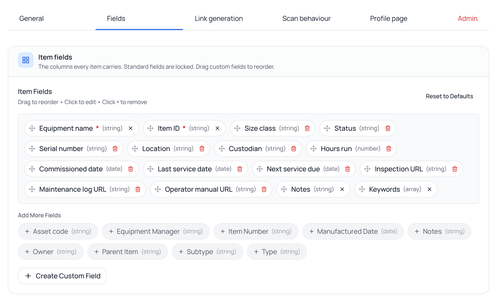

The `item` namespace reads the scanned Item's own data, and it is the namespace you will use for
almost everything. Write it as `{{item.field_name}}` in a Destination URL, or as `item.field_name`
without braces in a condition. See [Field Bindings & URL Templates](/destinations/field-bindings)
for the syntax rules and the encoding behavior.

The exact set of `item.*` fields depends on the Collection, because a Collection defines its own
fields. The tables below cover what every Collection has plus the standard fields you can add.

## Core fields

Four fields exist on every Item in every Collection, are stored in their own database columns, and
cannot be renamed or removed.

| Binding | Type | Notes |
|---|---|---|
| `item.name` | string | The Item's display name, for example `Excavator #203` |
| `item.item_id` | string | The Item ID — your own identifier, unique within the Collection, and the value ID-based Links are built from |
| `item.description` | string | Free-text description |
| `item.tags` | array | The field labeled **Keywords**, for example `["construction", "rental"]`. On a Page, `item.keywords` reads the same list |

## Standard fields

A Collection you start from scratch has only the four core fields. These standard fields are
offered under **Add More Fields** on the Collection's **Fields** tab, and a template may bring some
of them with it. They are ordinary configurable fields, not fixed columns: you can relabel, rename,
disable or delete them, and a field the Collection does not have resolves to nothing.



| Binding | Label | Type |
|---|---|---|
| `item.item_number` | Item Number | string |
| `item.serial_number` | Serial Number | string |
| `item.category` | Category | string |
| `item.type` | Type | string |
| `item.subtype` | Subtype | string |
| `item.status` | Status | string |
| `item.location` | Location | string |
| `item.owner` | Owner | reference to a team member |
| `item.equipment_manager` | Equipment Manager | reference to a team member |
| `item.notes` | Notes | string |
| `item.manufactured_date` | Manufactured Date | date |
| `item.parent_item` | Parent Item | reference to another Item |

**Owner, Equipment Manager and Parent Item are reference fields.** `{{item.owner}}` is the stored
ID of the team member, not their name. On a Page, `{{ref.owner}}` gives the person; a Destination
URL can only use the ID. See [Reference Fields](/fields/reference-fields).

**`item.item_number` and `item.item_id` are different fields.** Item Number is the standard
SKU-style field above; Item ID is the core identifier that Links can be generated from. There is
no `item.number`.

## System fields

These are set by QRtub, not by you, and are read-only.

| Binding | Type | Notes |
|---|---|---|
| `item.id` | string | QRtub's internal identifier for the Item — long and opaque; prefer `item.item_id` or `item.item_number` in a URL you have to read or support |
| `item.created_at` | date | When the Item was created, as an ISO timestamp |
| `item.updated_at` | date | When the Item was last changed, as an ISO timestamp |
| `item.image` | string | URL of the Item's image |

## Custom fields

Any field you add to a Collection is readable under its field key, with no extra prefix. A field
you created with the label "Inspection Due" and the key `inspection_due` is `{{item.inspection_due}}`
in a URL and `item.inspection_due` in a condition.

Field keys are lowercase letters, numbers and underscores, so a binding for a custom field is
always lowercase. If you are unsure of a key, type `item.` in a Destination URL or rule field: the
suggestions list every enabled field by its key.

Renaming a custom field does not break existing bindings. Changing a field's label changes its key
to match, and QRtub rewrites the Destination URLs, fallback URLs and conditions that used the old
key when you save the rename; Page template bindings are stored against a hidden stable identifier
that a rename never touches.

## Things that catch people out

**Field names are case-sensitive.** `item.Status` resolves to nothing. `item.status` works.

**Keywords cannot go in a Destination URL.** `item.tags` is a list, not a single value, and a
binding that resolves to a list makes a Destination URL or routing rule count as unresolved — the
Destination is skipped rather than opening with `construction,rental` pasted into it. Keywords work
normally in conditions, where you test them with `in` and `size()`:

```text
"crane" in item.tags
size(item.tags) > 0
```

**Switching a field off does not hide its value.** A disabled field drops out of the editors'
suggestions and the Page Editor's preview, but a published Page and Destination routing still read
whatever value a standard or custom field holds. To stop a value appearing, remove the binding or
clear the value.

**Dates are text, not numbers.** `item.created_at`, `item.manufactured_date` and any date
custom field come through as ISO-style strings. You can insert them into a URL, but you cannot do
arithmetic on them, and comparing one with the current date works only as a comparison of text —
see [Time Fields Reference](/destinations/time-fields) for how, and the sturdier alternative.

## Related

- [Field Bindings & URL Templates](/destinations/field-bindings) — the `{{ }}` syntax, encoding and missing-value rules
- [Core Fields vs. Custom Fields](/fields/core-vs-custom) — which fields are fixed and which you control
- [Collection Fields Reference](/destinations/collection-fields) — the `collection.*` catalog (`tub.*` in a Destination) for Collection-level data
- [What Is a Destination?](/destinations/what-is-a-destination) — conditional routing rules that send different Items to different URLs
