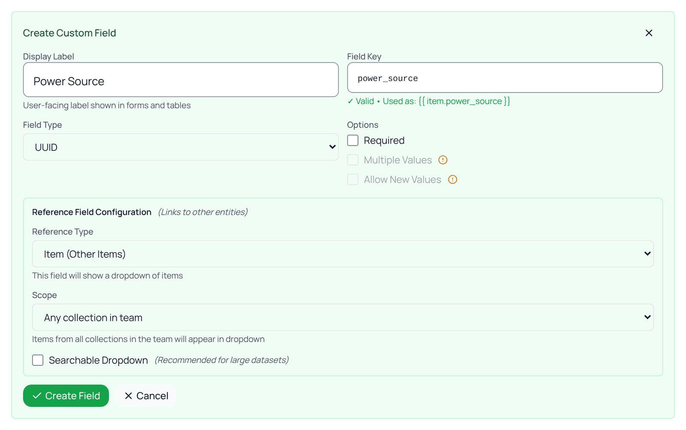
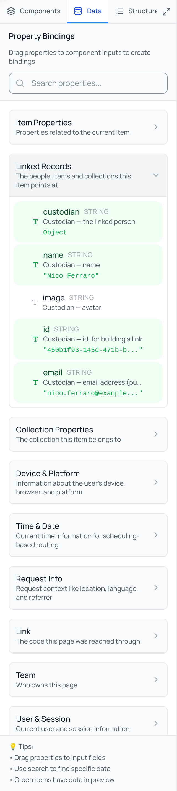

A reference field holds no value of its own. It stores the ID of another record in QRtub, and
displays that record's current name and image. This is how you model a relationship: an Item
that belongs to a site, or has an assigned owner.

That is what separates it from [Allowed Values](/fields/allowed-values), which is a fixed list
of literal values you author on the field itself. A reference field has no list to author —
its options are whatever records exist, and it never copies their data. Rename the referenced
record and every Item pointing at it shows the new name, because the name was never stored on
the Item.

## Setting one up

A reference field is a field with a reference type set. When you create a custom field,
choose UUID as the type and the reference configuration appears. The ready-made Owner,
Equipment Manager and Parent Item fields arrive with a reference type already set, on a Text
field.

Pick what the field points at:

| Points at | Options offered in the dropdown |
|-----------|---------------------------------|
| **A team member** | Everyone on the team |
| **Another Item** | Items in this Collection, or Items in any Collection on the team |
| **A Collection** | Any Collection on the team |

For an Item reference, that second choice is the **Scope** setting: same Collection only, or
any Collection in the team. Member and Collection references are always team-wide.

The list is sorted alphabetically. Once it holds more than eight records, the picker adds a
search box at the top, which matches names (and an Item's Item ID). The **Searchable Dropdown**
checkbox is saved with the field, but the Item form does not use it: the search box appears
or not by that count alone.

## What it looks like once it is set

The picker and the Items table both show the referenced record rather than an ID:

- a team member shows their avatar, name, and email,
- an Item shows its image, its name, and its Item ID,
- a Collection shows its image and name.

If the referenced record can no longer be resolved — it was deleted, or it is no longer on
your team — the cell falls back to a placeholder circle and the first characters of the
stored ID. Nothing is cleared automatically, so that is your signal that a pointer has gone
stale.

## Limits worth knowing before you commit

**In a Destination URL, a binding inserts the ID, not the name.** `{{item.parent_item}}`
resolves to the stored record ID, and the `ref` bindings described below do not exist in a
Destination URL or rule. If you need a human-readable value in a URL, put it in a Text field.
And remember that values are inserted into a URL exactly as stored, with no URL-encoding — a
value containing an `&` or a `#` will break the link, and a space can too.

If what you actually want in the URL is the Collection the Item belongs to, that is a
Collection binding rather than a reference field. In a Destination URL it is written
`{{tub.name}}`, the Collection's old name; `{{collection.name}}` only works on a Page.

**CSV import cannot fill a UUID reference field.** A UUID field's CSV cell has to be a JSON
object, so a bare record ID in that column is rejected as invalid. Set those from the Item
form. The ready-made Owner, Equipment Manager and Parent Item are Text fields, so there a
cell is stored as it is: a record ID fills the field, and nothing checks that the record
exists.

**A UUID field with no reference type is just a text box.** It has nothing to point at, so
the form falls back to plain text input. If the dropdown never appears, the reference type is
unset.

## Showing the referenced record on a Page

On a Page, `{{item.parent_item}}` is still the stored ID. To show the record itself, use the
`ref` namespace with the field's key:

- `{{ref.parent_item}}` shows the record's name,
- `{{ref.parent_item.name}}`, `{{ref.parent_item.image}}` and `{{ref.parent_item.id}}` give
  its parts (the image is a team member's avatar, or an Item's or Collection's image),
- `{{ref.owner.email}}` gives a team member's email address, which binding it publishes on
  the Page,
- a field holding several records, such as a List field with a reference type, shows them as
  a comma-separated list of names.

The Page Editor offers these on the **Data** tab under **Linked Records**, which appears only
when the Collection has a reference field. Only records on the Item's own team are looked up;
an ID from anywhere else shows as the ID. Like other Page bindings, a `ref` binding keeps
working when you [rename the field](/fields/renaming-a-field).

## Related

- [Allowed Values](/fields/allowed-values)
- [Custom Field Types](/fields/field-types)
- [Creating a Custom Field](/fields/creating-a-field)
- [Field Bindings](/destinations/field-bindings)
