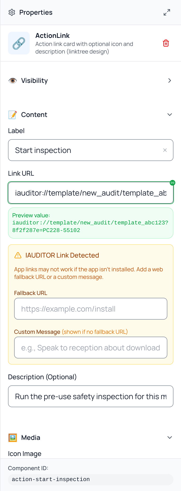
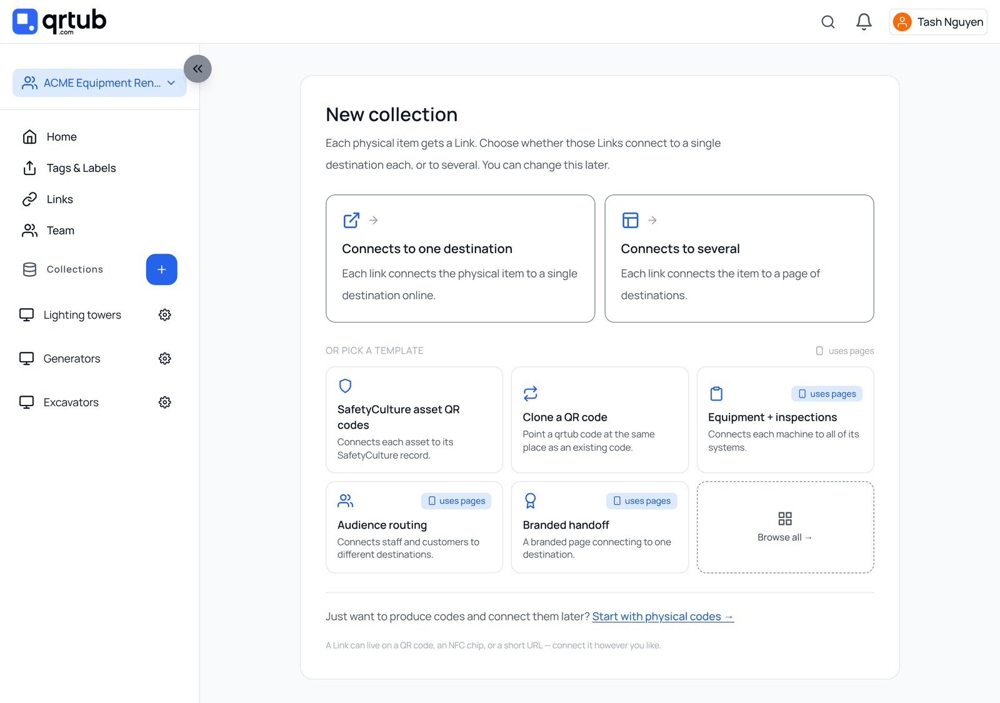

Point a QRtub Link at a Mitti destination and a scan lands straight on the right record — the inspection for this machine, its last report, its asset history, or a form a visitor can use without a Mitti account.

## If you know it as SafetyCulture or iAuditor

Same product, three names. It launched as **iAuditor**, was renamed **SafetyCulture**, and became
**Mitti** in August 2026. SafetyCulture remains the company; Mitti is the platform.

Nothing you have already set up stops working:

- The mobile app kept its identifiers, so the **`iauditor://` deep link scheme still works**. You
  will see it throughout this page, and it is correct — not a leftover.
- **`app.safetyculture.com` URLs still resolve.** Examples below use `app.mitti.com`, but you do
  not need to go back and change anything.

## Overview

Mitti (formerly SafetyCulture) is a workplace operations platform. Used with QRtub, you can:

- Open a specific inspection template by scanning the equipment it belongs to
- Carry each Item's own data into the link, which Mitti uses to pre-fill answers
- Offer several Mitti destinations on one code, so whoever scans picks what they came for
- Reach destinations Mitti has a URL for but does not make a QR code for — a training course, a
  report, or one question inside a long inspection
- Change which record a code opens without producing the tag again, including if you switch
  platforms later

## Integration Method

QRtub connects to Mitti using **deep links** — URLs that open Mitti directly at a specific
inspection, template or report. No data is exchanged between the two systems; QRtub builds the
URL and Mitti handles the rest.

Mitti supports two deep link formats:
- **Mobile app** (`iauditor://`) — opens the Mitti app. The scheme still carries the old name
- **Web app** (`https://app.mitti.com/`) — opens in a browser. `app.safetyculture.com` also works

## Getting Your Template ID

Before setting up deep links, you'll need your Mitti Template ID:

1. Open the Mitti web app
2. Navigate to your inspection template
3. Copy the Template ID from the URL
4. Example: `template_fcbc86fd41a74180921347e4be53bdf2`

See [Mitti's guide on getting entity IDs](https://help.mitti.com/en-US/000076/) for detailed instructions.

## Basic Setup: Start Inspection

### Mobile App Deep Link

On the Page, add an ActionLink section and fill in:

**Label:** Start Inspection
**Link URL:** `iauditor://template/new_audit/<template_id>`



For a code that opens Mitti directly, with no Page, put the same URL in the Item's **Default URL**
on its **Destination** tab instead.

**Example:**
```
iauditor://template/new_audit/template_fcbc86fd41a74180921347e4be53bdf2
```

### Web App Deep Link

Alternatively, use a web app deep link for users who prefer desktop/browser access:

**Label:** Start Inspection (Web)
**Link URL:** `https://app.mitti.com/inspection/new?templateId=<template_id>`

**Example:**
```
https://app.mitti.com/inspection/new?templateId=template_fcbc86fd41a74180921347e4be53bdf2
```

### Using QRtub URL Templates

Use QRtub's URL Template feature to automatically insert template IDs from your Item data:

**Link URL:** `iauditor://template/new_audit/{{item.template_id}}`

**Why this matters at volume:** Configure the Destination once with a template placeholder. Each Item in your Collection can have a different `template_id` field value—some use the forklift inspection template, others use the excavator template. One Destination configuration serves all equipment types, with each QR code routing to its specific inspection template automatically.

This allows different Items to use different Mitti templates based on their Item data—no manual configuration per Item.

A field labeled **Template ID** gets the key `template_id`; field keys are always lowercase with
underscores, so `{{item.templateID}}` would never resolve.

### Starting from the SafetyCulture template

To open each Item's asset record, you can skip the setup above: the **SafetyCulture asset QR
codes** [starter template](/collections/starter-templates) creates a Collection in Direct Mode
whose default destination is
`https://app.safetyculture.com/assets/{{item.safetyculture_asset_id}}`. Fill in each Item's
**SafetyCulture asset ID** and its code opens that asset in Mitti.



## Related

- [What a Scan Can Open in Mitti](/integrations/mitti/entities)
- [Pre-filling a Mitti Inspection](/integrations/mitti/prefilling)
- [Fallbacks and Troubleshooting](/integrations/mitti/troubleshooting)
