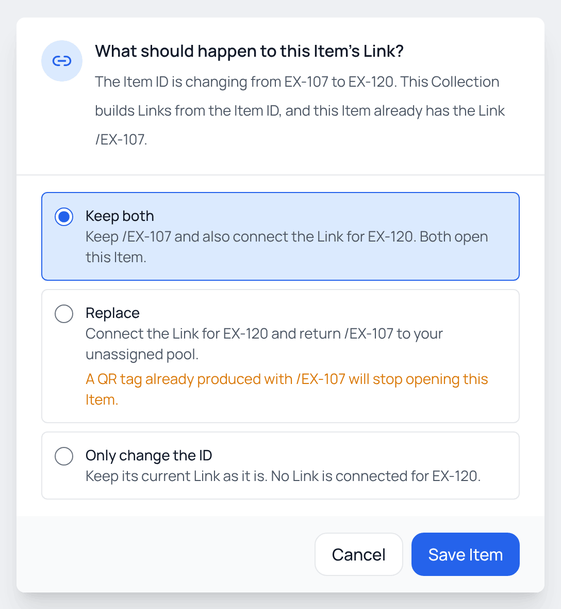

Item ID is your own identifier for an Item — the plant number, asset number, or tag number your
business already uses. Unlike Name, it is unique within the Collection, which makes it the field
you use to tell two similar Items apart.

## Uniqueness and blank values

No two Items in the same Collection can hold the same Item ID. The constraint is per Collection,
so "EXC-203" in Heavy Equipment and "EXC-203" in Hire Fleet are fine — the same value twice in
one Collection is rejected.

Item ID is optional, unless the Collection builds Links from Item IDs (below). Values are
trimmed before they are stored, and a blank or whitespace-only value is stored as no value at
all, so any number of Items in a Collection can have no Item ID without colliding with each
other. Trimming also means `" EXC-203 "` and `"EXC-203"` are the
same Item ID, not two different ones.

## Where Item ID appears

- In the items table, and as the subtitle under an Item's name when another Item references it
  through a reference field.
- In the search box of a reference field's item picker inside the item form, alongside Name.
- In bindings, as `{{item.item_id}}` — usable in a Destination URL such as
  `https://example.com/items/{{item.item_id}}`. Bindings are inserted exactly as stored with no
  URL encoding, so keep Item IDs free of spaces and `&` if you build URLs from them.

## Item ID and ID-based Links

If the Collection generates Links from Item IDs, the Item ID *is* the Link's slug. The
Collection defines a numbered pattern — an optional prefix, a digit count, and an optional
suffix, such as `CRA####TL` — and an Item with the Item ID `CRA0042TL` gets the Link
`qrtub.com/CRA0042TL`. In the item form the prefix and suffix sit either side of the box, so you
type only the number.

That mode adds real rules to this field:

- The Item ID must match the mask. The check runs in the item form, in the API, and on CSV
  import, and a value like `CRA42TL` is rejected for having the wrong number of digits.
- The item form and CSV import require an Item ID ("Item ID is required for this Collection.").
  An Item that still ends up with none — a duplicate of an Item that had none, for instance — is
  created without a Link, and you see a message saying so.
- If that slug already exists as an unassigned Link — a Tag produced in advance — a CSV import
  adopts the existing Link rather than duplicating it. The item form does not: when you create an
  Item, it treats any number that already has a Link as taken ("…is already taken — pick another
  number."), as it does a number whose Link belongs to a different Item.

None of this applies in the other link-generation modes, where Item ID is simply an identifier
you keep for your own reference.

## Changing an Item ID

In a Collection that builds Links from Item IDs, saving a new Item ID on an existing Item also
decides what happens to its Links:

- **The Item has no Link yet.** The Link for the new Item ID is connected straight away, and the
  confirmation says so ("Item updated. Link /CRA0043TL is now connected to it.").
- **The Item already has a Link.** Nothing is saved until you answer *"What should happen to this
  Item's Link?"*. **Keep both** (selected to start with) keeps the current Link and also connects
  the new Item ID's Link. **Replace** connects the new Link and returns the one built from the old
  Item ID to your unassigned pool, so a Tag already produced with it stops opening this Item; it
  is offered only when such a Link exists. **Only change the ID** leaves the Links as they are.
- **The new Item ID's Link belongs to another Item.** The change is refused and you are asked to
  pick an unused number.

A change of letter case only is not treated as a change. In the other link-generation modes,
changing an Item ID never touches Links. See [Deleting, Unassigning, and Releasing
Links](/links/deleting-and-releasing-links) for what the unassigned pool means.

## Two behaviors that surprise people

**Duplicating an Item never copies its Item ID**, because the copy would collide on the
uniqueness constraint. You are prompted for a new one instead.

**On CSV import, duplicate Item IDs are caught in the preview**, before anything is written —
both a value already used by another Item in the Collection and the same value appearing twice
in the file. Those rows are rejected individually; the rest of the file still imports.

## Related

- [What Is an Item?](/items/overview)
- [Name and Description](/items/name-and-description)
- [Duplicating an Item](/items/duplicating)
- [Importing Items from CSV](/import-export/importing-items)
