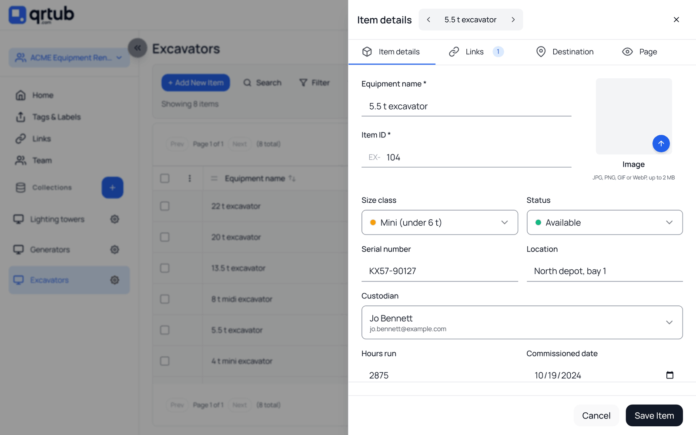

An Item is one record inside a Collection: one excavator, one fire extinguisher, one meeting
room, one product. Items are what you actually manage — the things your QR codes point at.

Every Item belongs to exactly one Collection, and the Collection decides what fields that Item
has. Add a "Service Hours" field to the Collection and every Item in it gains that field.

## What every Item is made of

Four **core fields** ship on every Item and cannot be removed: **Name**, **Item ID**,
**Description** and **Keywords**. They live in fixed database columns. You can mark them required
or turn them off in the Collection's Fields tab, but their labels and keys are locked — the keys
are `name`, `item_id`, `description`, `tags`.

Everything else is a **custom field** the Collection defines: a serial number, an inspection
date, a status, a reference to the site the Item sits on. Custom fields are stored against a
stable internal identifier, which is what makes renaming one safe later.

## The Item photo

Every Item can also carry one photo. It is a system field, not part of the Collection's field
configuration, so it cannot be renamed, disabled, or duplicated as a second image slot. Upload
it from the item form: a JPG, PNG, GIF or WebP file, up to 2 MB.

That photo appears in three places: the items table, the Item's Page wherever the
`{{item.image}}` binding is used, and the preview shown when another Item references this one
(a reference field displays the referenced Item's photo, name, and Item ID rather than a raw
identifier).

The photo is the one field CSV does not carry. It is excluded from every CSV export and
ignored on import, so a CSV round-trip never changes or clears it.

## How an Item relates to Links and Pages

An Item is not a Link. A Link is the QRtub-managed URL a QR code encodes; the Item is the
record it resolves to. An Item can have no Links, one Link, or several. Depending on the
Collection's link-generation setting, a Link is minted automatically the moment the Item is
created.

When a Link pointing at this Item is scanned, the Collection's page template renders using
this Item's values — `{{item.name}}`, `{{item.status}}`, and so on. Two things to know about
those bindings:

- Values are inserted **exactly as stored**, with no URL encoding. A field containing `&` or `#`
  will break a Destination URL built from it, and a space or `?` can too.
- Collection fields use the `collection.` prefix on a Page — `{{collection.name}}` returns the
  Collection's name. In a Destination URL the Collection is still read as `tub.`
  (`{{tub.name}}`); see [Collection Details](/collections/collection-details).

Deleting an Item does not delete its Links. They are released back to your unassigned Links, so
Tags already produced and stuck to physical things keep resolving.

## Selecting many Items

In the items table, ticks stay as you move between pages. The header checkbox selects every Item
matching the current search and filters, on every page, and a banner says so (*"All 240 matching
items are selected, including those on other pages."*) with **Clear selection**. Untick rows to
leave them out; the header checkbox then shows a dash. Changing the search, filters or sort clears
the selection. Bulk actions such as **Duplicate Selected Items** and **Delete Selected Items** act
on the whole selection, so check the count in the confirmation (*"Are you sure you want to delete
these 240 items?"*) before you confirm.

## Related

- [Name and Description](/items/name-and-description)
- [Item ID](/items/item-id)
- [Keywords](/items/keywords)
- [What Is a Collection?](/collections/overview)
