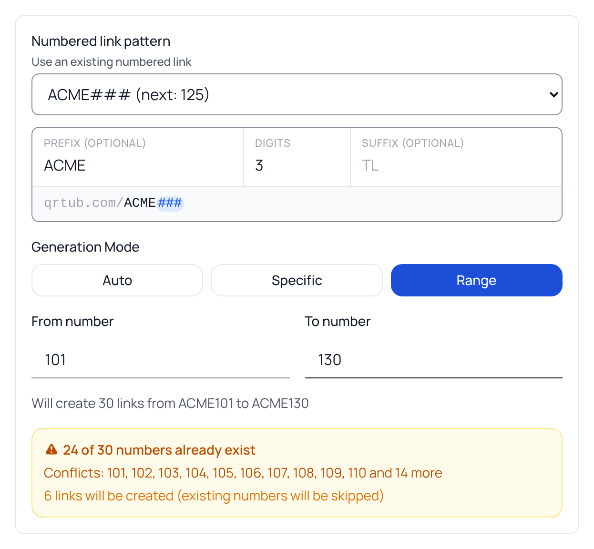

A Numbered Link has a slug built from three parts you decide: a prefix, a zero-padded number, and a suffix. Claim the pattern `CRA` + 4 digits + `TL` and you get `qrtub.com/CRA0042TL`. It exists so the address on a tag can be the same identifier as the number stamped on the tag — one number for your crew to remember instead of two.

Numbered patterns are included in the Professional plan (one pattern) and Scale (up to five). The Starter plan covers Random and Custom Links: on a plan without numbered patterns, the **Numbered** button in the create form carries a lock, and choosing it shows which plans include them instead of the pattern fields.

## The pattern is what you actually reserve

A pattern is the combination of prefix, digit count and suffix. `CRA` + 4 digits + `TL` reserves the whole space from `CRA0000TL` to `CRA9999TL` for your team — not just the numbers you have used so far.

Three things follow from that:

- **A pattern is claimed exclusively across all of QRtub.** If another team already holds that combination, a pattern that would share some of its addresses, or a Link whose address falls inside it, you cannot claim it, and QRtub tells you so instead of quietly giving you something else.
- **Matching ignores case, storage does not.** The affixes are stored exactly as you typed them, so the address can print as `CRA0042TL`, while `cra0042tl` still resolves. You cannot own both `CRA` and `cra` versions of the same pattern — they are the same pattern.
- **The reserved space is protected from Custom Links too.** A custom slug that would land inside a pattern you own — `cra0042tl`, or any other number in that range — is rejected even though no Link has been minted at that number yet.

Set the digit count deliberately. It can be 1 to 15 digits, it is part of the pattern's identity (3 digits and 4 digits are two different patterns), and it sets the ceiling: a 3-digit pattern stops at 999, and QRtub refuses to mint a number that does not fit rather than producing an over-length slug.

You can claim a pattern up front, by choosing **Create an ID-based link** in a Collection's settings and saving, or just start creating Links with it — the first Link claims the pattern automatically if it is free.

## What a prefix and suffix may contain

Both are optional. Each may use only letters, digits, hyphens and underscores, up to 20 characters, and the address they make has to follow the custom-slug character rules: 3 to 50 characters in all, starting with a letter, digit or underscore, ending with a letter or digit, and no two hyphens in a row. The form refuses anything else, such as a space, a slash, `?`, `&` or `#`, before you can create a Link, and says which part to fix.

## The three ways to mint a number

Once a pattern exists, choose a **Generation Mode** in the create form:

**Auto** takes the next number in the sequence and moves the counter forward. This is the everyday mode — create ten Links and you get the next ten numbers. Auto never goes back to fill a hole left by a deleted Link. When the pattern has issued every number it holds, Auto refuses and says so, for example "The pattern CRA####TL has issued all 10000 of its numbers."

**Specific** mints one exact number, which is how you fill those holes. `0` is a valid number (it mints `CRA0000TL`). If the number already exists, QRtub rejects the request and tells you which address is in the way rather than creating a duplicate.

**Range** mints a block: enter a From and To number and QRtub creates everything between them. This is the mode for a print run.

## Range mode checks for conflicts before it commits

Before you confirm a range, QRtub checks the requested numbers against what already exists and shows you the answer: how many of the numbers you asked for are available, how many already exist, and which specific numbers those are (the first ten, plus a count of the rest). If the pattern is owned by another team, you find out here rather than after the fact.

Confirm, and the numbers that already exist are **skipped** — you get Links for the available numbers only, and nothing existing is overwritten. So requesting 1–500 when 12 numbers are already used creates 488 Links.

One range request is capped at 1,000 numbers. Larger runs are several requests: the app warns you before you submit, and the server refuses the request with "Range too large. Maximum 1000 numbers per request."

## Deleting a pattern

The app has no control for deleting a pattern. Once your team has claimed one it stays claimed, and it keeps counting toward your plan's pattern limit, so choose the prefix, digit count and suffix with that in mind.

Deleting the pattern's Links does not release it, and neither does unassigning them from their Items.

## Related

- [Choosing a Link Type](/links/choosing-a-link-type) — numbered versus random versus custom
- [Deleting, Unassigning, and Releasing Links](/links/deleting-and-releasing-links) — what blocks deleting a Link, and what to do instead
- [Bulk Link Import via CSV](/bulk-links/csv-import) — creating numbered Links from a spreadsheet of existing asset numbers
- [Building an Item ID Mask](/collections/item-id-mask) — using a pattern as a Collection's Item ID format
