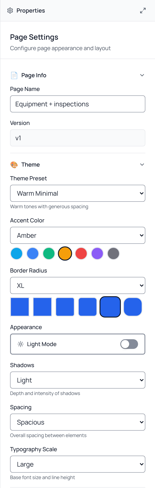

Theming lives in **Page Settings**, which is what the Properties panel shows when nothing on the
page is selected. Click any empty area of the canvas to get there.

The theme belongs to the page template, so it is a Collection-wide decision: change the accent and
every Item in the Collection changes with it.

## Start with a preset

**Theme Preset** offers seven complete looks:

| Preset | Character |
|--------|-----------|
| **Classic Light** | Clean and professional with subtle accents |
| **Professional Dark** | Sophisticated dark theme for modern brands |
| **Warm Minimal** | Warm tones with generous spacing |
| **High Contrast** | Maximum readability with bold accents, square corners |
| **Soft Pastel** | Gentle colors with very rounded corners |
| **Vibrant Modern** | Bold colors with compact spacing |
| **Monochrome** | Timeless grayscale with subtle depth |

**Choosing a preset replaces the entire theme rather than merging with your current settings** —
accent, radius, shadows, spacing, typography, light/dark, and any custom colors you had entered.
So pick the preset first and adjust afterwards. Changing a value by hand does not change the
dropdown: it keeps showing the last preset you chose, so read it as where the theme started, not as
a description of it now. The dropdown reads "Custom / No Preset" only on a page that has never had a preset, and
picking it does nothing.

## The individual controls

| Setting | Options |
|---------|---------|
| **Accent Color** | Seven named accents: Sky, Blue, Green, Amber, Red, Violet, Zinc. This is a fixed palette, not a color picker — each accent is a coordinated set of shades used for buttons, links and the toolbar |
| **Border Radius** | None, SM, MD, LG, XL, 2XL — applied to cards, buttons and image corners together |
| **Appearance** | Light Mode or Dark Mode |
| **Shadows** | Light, Normal, Heavy |
| **Spacing** | Compact, Normal, Spacious — the rhythm between sections |
| **Typography Scale** | Small, Medium, Large — base font size and line height |

**Custom Colors (Optional)** goes underneath, with seven slots you can override individually:
Background, Surface, Surface Accent, Border, Text Primary, Text Secondary, and Text on Accent. A
slot takes a six-digit hex value such as `#1A2B3C`: type it, or pick it with the color swatch beside
the slot. Each slot has a clear control to hand the color back to the theme.

**Switching Appearance clears your custom colors.** Toggling between Light and Dark discards
everything in the Custom Colors block so the light or dark defaults can take over. Decide light or
dark before you hand-pick colors, not after.

## Page width and padding

The **Layout** group sets the container the whole page renders in:

- **Max Width** — SM through 2XL, or Full Width. Pages are almost always read on a phone, so this
  mostly governs what happens on a desktop browser: a narrow max width keeps the page looking like
  a phone screen, Full Width lets it stretch.
- **Padding** — the space between the page content and the edge of the screen, from None up to 12.

## Reading theme values in a binding

The **Data** tab does not offer theme values: shown as text, they read as a token name rather than
a color. A `{{theme.accent}}` or `{{theme.radius}}` binding still resolves if you type it, or if an
older page already has one. It returns the *token name* rather than a color or a pixel value —
`sky`, `xl` — so it is useful in a Custom Styles expression that needs to follow the theme, and not
useful as a color you can display.

## What the theme does not cover

- **There is no logo or brand image setting in the theme.** Put a logo on the page as an
  ImageSection or in a TubInfo section instead. An ImageSection bound to `{{team.logo}}` shows
  the **Team logo** from your team settings.
- **There is no per-Item theme by design**, but an Item override can carry one. When it does, the
  Item stores the entire theme rather than the one value you changed — so later changes to the
  Collection's theme will not reach that Item at all. See [Per-Item Page
  Overrides](/pages/page-overrides).
- **Custom Styles on individual sections** are a separate mechanism from theming, set per section in
  the Properties panel, and they override whatever the theme decides.

## Related

- [The Page Editor Layout](/pages/page-editor-layout)
- [Previewing a Page](/pages/previewing-a-page)
- [Per-Item Page Overrides](/pages/page-overrides)
- [Image Display Controls](/pages/image-display-controls)
