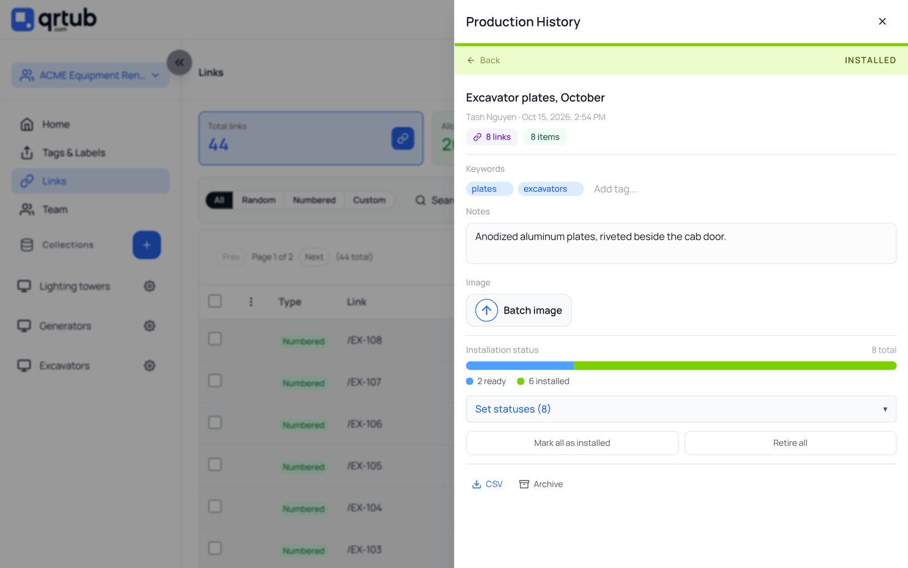

A batch arrives with an automatic name like `Production list — Aug 18, 2026`, which tells you
nothing in six months. The batch panel gives you four fields to fix that, and all four stay
editable at every status — including Installed.

## Renaming a batch

Click the batch name at the top of the panel and it becomes an input. **Enter** or clicking away
saves; **Escape** cancels. An empty name is ignored, so you cannot accidentally blank it.

Names are what the search boxes on Tags & Labels and in Production History match on, so make them
searchable rather than decorative: "Depot 2 replacements, March" beats "Batch 14".

## Notes

The **Notes** box is free text and saves when you click out of it. Use it for the things you will
want and never remember — the supplier, the material and finish, the quote number, the reason
for the run, anything odd about the order.

Notes are searched alongside the name on the Tags & Labels page, so a supplier name typed here is
enough to find every run you ordered from them.

## Keywords

The **Keywords** field holds chips, one word or phrase each, for grouping runs that belong
together — `depot-2`, `stickers`, `reprint`, `q3`.

- Type and press **Enter** to add a keyword. A trailing comma adds it too, so you can type
  `depot-2, stickers,` straight through.
- **Backspace** in the empty box removes the last keyword.
- Click the **x** on a chip to remove that specific keyword.
- Keywords are stored lowercase, and one you already have is ignored rather than duplicated.

In the Production History panel, every keyword in use appears as a filter chip, so keywords are
the fastest way to pull up "every reprint" or "everything for depot 2" later.

## Cover photo

The **Image** field takes one photo of the finished Tags — the printed sticker on the roll, the
engraved plaque, the sign on the wall. Upload a JPG, PNG, GIF or WebP image of up to 2 MB; it is
stored privately and served back through QRtub rather than from a public URL. Uploading another
replaces it.

Once set, the photo appears as a thumbnail beside the batch in the Production History list, which
makes visual identification much faster than reading names. Deleting the batch deletes the photo
with it.

A photo is a useful stand-in for the Tag detail QRtub does not track — there is no field for
material, cost or supplier, so a picture plus a line in the notes is the practical substitute.

## Related

- [Finding and Filtering Your Batches](/print-batches/finding-batches)
- [Print Batches](/print-batches/overview)
- [What Is a Tag?](/tags/what-is-a-tag)
