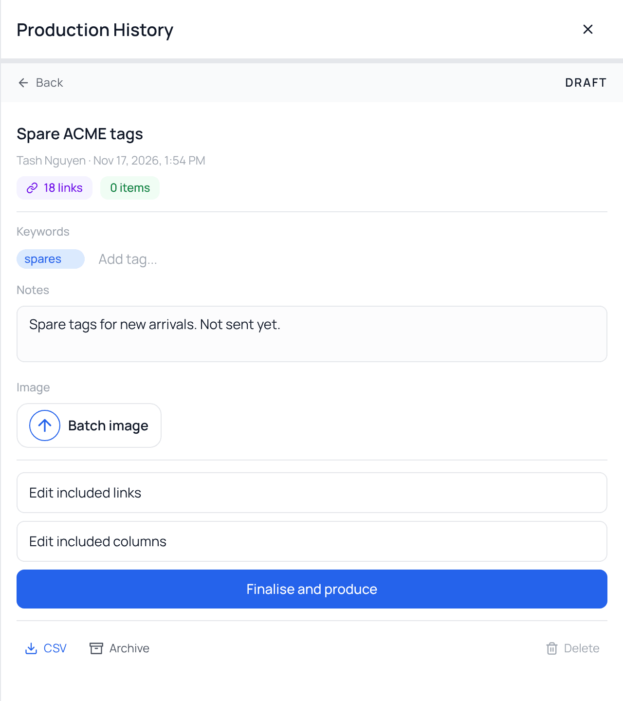

Every batch carries **one** status covering the entire run: Draft, In Production, Ready or
Installed. It describes where the order is, not where any individual Tag ended up. The
per-code equivalent is a separate thing entirely — see
[Tracking Status Per Code](/print-batches/per-code-status).

You change it from the batch detail panel, which shows the current status in the header and one
primary button for the next step.

## The four stages

| Status | Meaning |
|---|---|
| **Draft** | Prepared, not yet sent to the supplier. The only stage where its links and columns can still change. |
| **In Production** | With the supplier, or being made in-house. |
| **Ready** | Made or received, not yet installed. |
| **Installed** | Out in the field. |

## Moving forward

Each stage has one named action, and it only ever moves one step:

- Draft → In Production: **Finalise and produce**
- In Production → Ready: **Mark as ready**
- Ready → Installed: **Mark as installed**

You cannot skip a stage. There is no way to take a Draft batch straight to Installed.

## Stepping back

In Production and Ready each offer a revert button — **Revert to draft** and **Revert to in
production** respectively — one stage back, no further.

**Installed is terminal.** There is no revert out of it, and no way to reopen an Installed batch
for editing. Advance to Installed once the codes are genuinely out, because that decision is
permanent for that batch.

Draft has nothing behind it, so it has no revert either.

## What each status changes

The status is not just a label — it gates what the batch will let you do:

| Only while Draft | Only once Installed |
|---|---|
| Add or remove links | The per-code installation tracker appears |
| Change the CSV columns | |
| Delete the batch outright | |

Two more stage-specific behaviors:

- **In Production** adds a **Share with supplier** shortcut, which is simply a download of the
  stored CSV.
- Past Draft, the links inside the batch are protected from deletion — a code may already be
  on a Tag fixed to something, so removing it from QRtub would strand the physical item.

Name, notes, keywords, the cover photo, archiving, and the CSV and QR code downloads are available
at every stage.

## Related

- [Tracking Status Per Code](/print-batches/per-code-status)
- [Adding and Removing Links in a Batch](/print-batches/editing-links)
- [Archiving and Deleting Batches](/print-batches/archiving-and-deleting)
- [Batches](/print-batches/overview)
