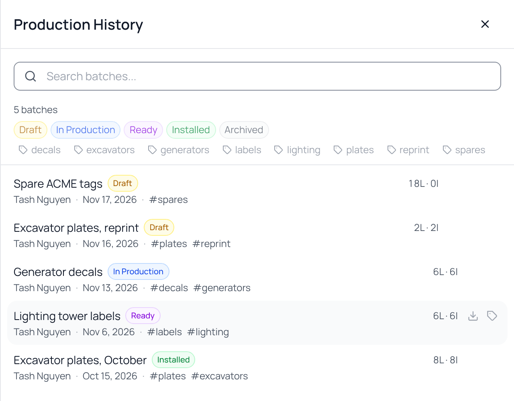
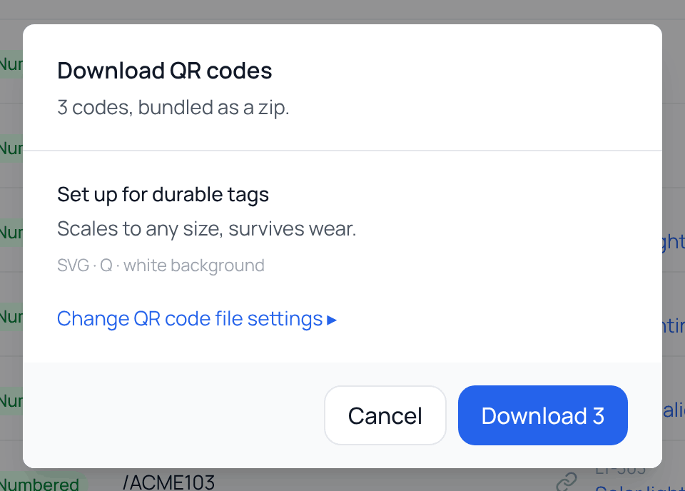

Every tracked batch keeps its CSV. The file is stored with the batch rather than rebuilt each
time you ask for it, so downloading it a year later gives you the same list the supplier worked
from — not a fresh export that has quietly drifted as Items were added, renamed or deleted.

That is the whole point for reprints: order the same fifty replacement plaques and you are
ordering the same fifty codes.

## Downloading it

There are three places the same download appears:

- **The batch list** — hover a row in the Production History panel and click the download icon
  (**Download CSV**). It only appears on batches that have a stored file.
- **The batch panel footer** — the **CSV** button, available at any status.
- **Share with supplier** — a large button shown while the batch is In Production. It is the
  same download, named for the moment you actually need it.

The file streams from QRtub itself, so there is no expiring share link to manage and no
storage URL to keep track of. The download is named after the batch: a batch called
"Depot 2 replacements" downloads as `Depot_2_replacements.csv`. Characters that are awkward in
filenames become underscores, very long names are trimmed, and a batch whose name reduces to
nothing falls back to `batch.csv`.

Renaming the batch changes the filename of subsequent downloads — a good reason to give a run a
sensible name before you send it anywhere.

## When the file is rebuilt

The stored file is only regenerated by an edit you make while the batch is still a **Draft**:

- changing which columns it contains
- adding links to it
- removing links from it

Each of those rewrites the file from current data, replacing the previous version; removing the
last link leaves a file with just the header row. Once the batch
leaves Draft, none of those edits are possible, so the file is frozen for the life of the batch.
See [Editing a Batch's Columns](/print-batches/editing-columns) and
[Adding and Removing Links in a Batch](/print-batches/editing-links).

## What is in it

One row per link, with the columns chosen at export: Link, Short URL, Active, plus whichever
Item fields you picked. A batch exported from a Collection lists the Item columns first, and keeps
a row with empty link columns for any exported Item that had no Link; one exported from the Links
page lists the link columns first. Most suppliers need only the Link column — their software
generates the QR image from that value. Files from older batches may head it **Full URL** or
**Access Link** instead.

In a batch exported from a Collection, each Item column is headed with the field's label as the
Collection shows it. Dates are written as YYYY-MM-DD. An Item value that begins with `=`, `+`,
`-`, `@`, `|`, a tab or an apostrophe is written with one extra apostrophe in front (a phone
number `+61 400 000 000` arrives as `'+61 400 000 000`), so spreadsheets do not run it as a
formula. A spreadsheet hides that apostrophe, but data-merge software reads the file as it is and
will put it on the Tag, so check those columns on the proof. The link columns are never changed.

## The batch's QR codes

If your supplier wants image files rather than a CSV, download the batch's QR codes as a zip.
Hover the batch's row in the Production History panel and click **Download this batch's QR codes**
(the tag icon beside the CSV download). It opens the QR code download dialog — SVG, error
correction Q and a white background unless you change them — and saves one file per link,
`qr-code-<slug>.svg` (or `.png`), in a zip named after the batch: "Depot 2 replacements" downloads
as `Depot-2-replacements-qr-codes.zip`.

Unlike the CSV, the codes are not stored with the batch. They are generated from the batch's
current list of links each time you download. For the file settings, see
[Downloading QR Codes](/bulk-links/downloading-qr-codes).

## When there is no file

Two cases where a download is not on offer:

- **The batch has no stored CSV.** Batch creation and CSV upload are separate steps, and if the
  upload failed the batch exists with no file attached. The download button is simply absent, and
  a direct request returns "No CSV file available for this batch". The fix is to re-export; while
  the batch is still a Draft, changing its columns or links also writes a fresh file.
- **You exported without tracking.** The **CSV** option on the export dialog downloads a file and
  creates no batch, so nothing is stored anywhere. That copy on your computer is the only one —
  see [Creating a Batch](/print-batches/creating-a-batch).

## Related

- [Creating a Batch](/print-batches/creating-a-batch)
- [Editing a Batch's Columns](/print-batches/editing-columns)
- [Viewing a Link's Production History](/print-batches/link-print-history)
- [Preparing Your Print Job](/suppliers/preparing-your-job)
