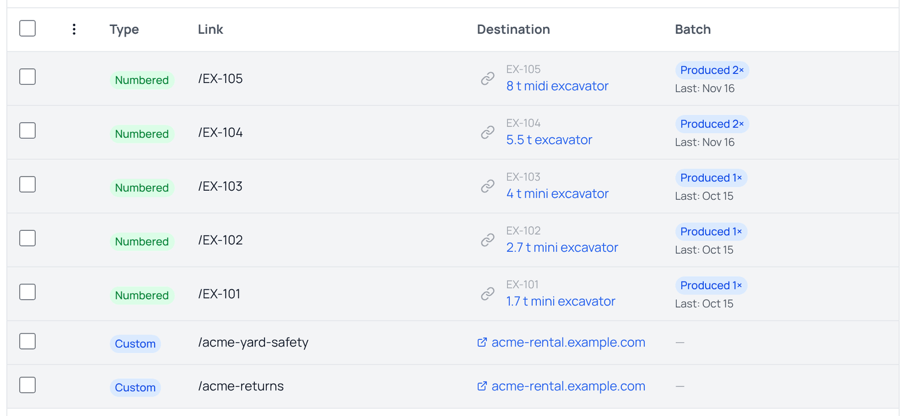
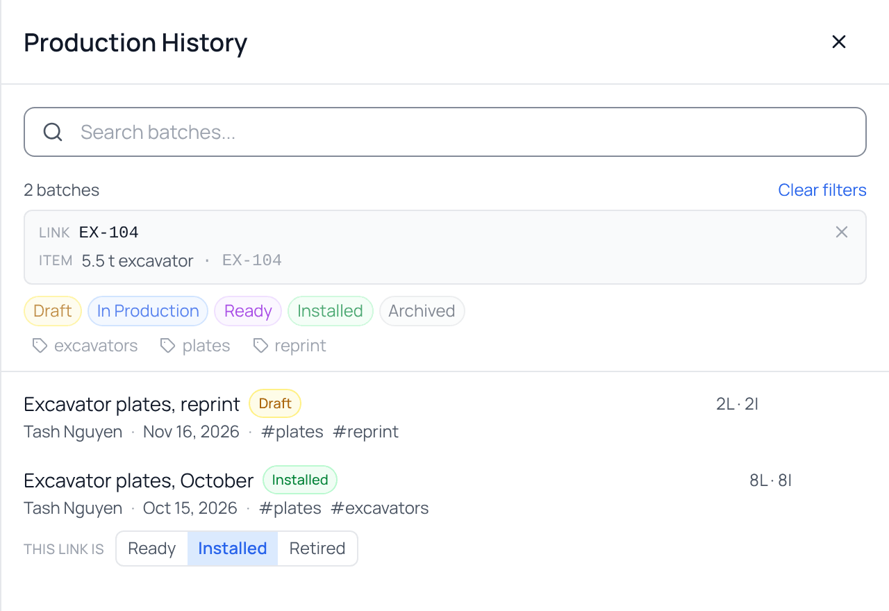

The batch pages answer "what was in that order?". This one answers the opposite question: given
one code, which orders has it been in? Useful when a plaque needs replacing and you want to know
what it was produced with, or when you suspect a code has been produced twice.

## Opening it

On the **Links** page, the **Batch** column summarizes each link's production record —
`Produced 3×` with `Last: Mar 9` beneath it. Click that summary to open the **Production History**
panel filtered to that link. A link that has never been in a batch shows a dash and has nothing to
open.

The panel header repeats the link's slug, where it points, and the Item it is assigned to, so you
do not lose track of which code you clicked.

## What you see

Every batch the link has appeared in, newest first. Each row carries:

- the batch name and its status badge — Draft, In Production, Ready or Installed
- who exported it and when
- the batch's keywords and cover photo
- the batch's link and item counts
- on hover, downloads of that batch's stored CSV and of its QR codes as a zip

Archived batches are included here. Archiving hides a batch from the default batch list, but it
never hides the fact that a code was produced in it.

If the link appears twice, it was produced twice — one row per run. That is exactly how you catch a
code that was produced again without anyone meaning to.

## Setting this link's installation status

On a batch that has reached **Installed**, the row shows a small **This link is** control with
Ready / Installed / Retired. It sets the installation status of *this one code in that one batch* —
not the batch, and not the other codes in it. Rows for batches that have not reached Installed do
not show the control, because those codes are not out in the field yet.

It is the same value you would set from the batch's installation tracker, reached from the other
direction. Use the tracker when you are working through a whole run; use this when you are
following a single code. See
[Tracking Status Per Code](/print-batches/per-code-status).

## What production history does not tell you

- **Nothing about scans.** QRtub records that a code was in a batch, not that anyone scanned it.
  "Produced 3×" counts batches, not activity in the field.
- **No timeline of changes.** You see each batch's export date, not a per-code history of status
  changes.
- **Nothing about the physical piece.** There is no material, cost or supplier field per code —
  the batch's notes and cover photo are where that context lives.

## Related

- [Tracking Status Per Code](/print-batches/per-code-status)
- [The Batch CSV: Downloading and Reprinting](/print-batches/csv-download)
- [Finding and Filtering Your Batches](/print-batches/finding-batches)
- [Unallocated Links](/links/unallocated-links)
