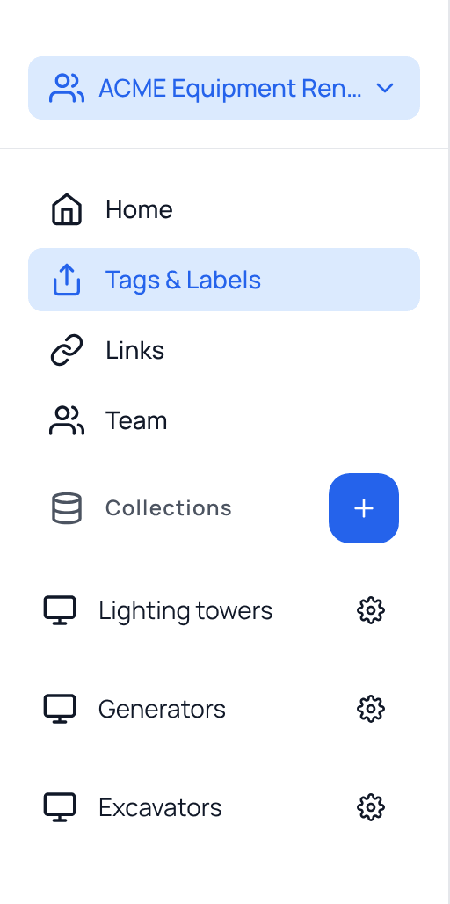

When you export a production list, QRtub can keep the run as a **batch**. A batch is the record of
one export: which links were in it, the CSV file that went to the supplier, who exported it and
when, and how far along the run is. Months later it answers the question a spreadsheet never
does — "what was in that order, and where did it go?"

Batches live under **Tags & Labels** in the main navigation.

## What a batch stores

| Kept with the batch | Notes |
|---|---|
| The list of links | One row per link, deduplicated |
| The exported CSV | The exact file, stored, not rebuilt on demand |
| Name, notes, keywords, cover photo | All editable at any time |
| Batch status | One value: Draft, In Production, Ready or Installed |
| Per-code installation status | One value per link: Ready, Installed or Retired |
| Who exported it, and when | Shown in the batch panel and on every Production History row |

## Two different statuses, two different scopes

This trips people up, so it is worth being blunt about it. The two things share vocabulary but
count differently:

- **Batch status** is a single value for the whole run. One batch, one status. It answers
  "has this order come back from the supplier yet?" See
  [Batch Status: Draft to Installed](/print-batches/batch-status).
- **Installation status** is one value per code — 500 Tags means 500 independent values. It
  answers "which of these are actually stuck to something?" See
  [Tracking Status Per Code](/print-batches/per-code-status).

A batch marked Installed does not mean every code in it is installed, and marking every code
installed does not move the batch. Neither one changes the other.

## What batches do not record

Batches track production runs, not individual Tags. There is no per-code record of
material, cost, durability, supplier or install location, and no Tag inventory. Scans are not
recorded either — QRtub records that a code was in a batch, not that it was later scanned.

If you need that context today, the batch's notes, keywords and cover photo are the place to put
it.

## Related

- [Creating a Print Batch](/print-batches/creating-a-batch)
- [Finding and Filtering Your Batches](/print-batches/finding-batches)
- [What Is a Tag?](/tags/what-is-a-tag)
- [The Print-First Workflow](/print-first/overview)
