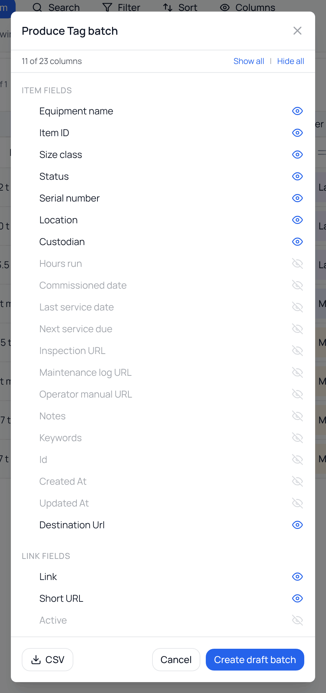

Matching is manual, and it turns on the slug. Every downloaded QR code image is named after its Link's slug — a Link at `qrtub.com/bepjov` downloads as `qr-code-bepjov.svg` (or `.png`, if you chose PNG). The same slug appears at the end of the **Link** and **Short URL** columns of an exported production list. Match on the slug.

The catch: **neither column is a byte-for-byte match for the filename.** Whoever does the matching has to strip a prefix first.

## What each column actually contains

When you export, the column picker that **Production List** opens has **Link** turned on by default and **Short URL** turned off, so turn Short URL on with its eye icon if you want it in the file.

| Column | Value for a random Link | Value for a numbered or custom Link |
|---|---|---|
| Filename | `qr-code-bepjov.svg` | `qr-code-cra0042.svg` |
| **Short URL** | `/bepjov` | `/cra0042` |
| **Link** | `https://qrtub.com/bepjov` | `https://qrtub.com/cra0042` |

So:

- **Short URL** carries a leading slash. Every Link type has the same shape, so stripping that one character gives you the slug.
- **Link** carries the protocol and domain on top of that.
- The filename carries the bare slug plus `qr-code-` and `.svg` or `.png`. Inside a ZIP, a `/` in an older slug becomes `_`, and a name that would clash gets `-2`, `-3`.

The production list has no column holding the bare slug. (The Links page's **Export** file has one, `url`, but it lists every Link on your team rather than the rows you are producing.) Any tool doing the match — a Canva Bulk Create sheet, an Illustrator or Photoshop script, a few lines of Python, or a spreadsheet formula — has to do the transformation itself.

## The transformation

Going from a filename to a slug is the simpler direction: drop the `qr-code-` prefix and the `.svg` or `.png` extension.

Going the other way, from a column to a slug, means stripping the protocol and domain if you started from **Link**, then the leading `/`. In a spreadsheet, the usual approach is a formula that takes everything after the last `/` in the URL — that handles both columns in one pass, because the slug is always the final path segment.

Whichever direction you go, build the key once in a helper column and match on that, rather than eyeballing hundreds of rows.

## Why the mismatch matters

Because a wrong match is invisible. Two codes are the same size, the same colors, the same visual noise. A batch where rows and images got offset by one produces plaques that look flawless and send every scan to the wrong item. There is no error, no warning, and no way to tell by looking.

That is why the check happens on a proof, with a phone, and not on screen.

## The shortcut: skip the images entirely

If your shop's software can render QR codes directly from text — many variable data printing toolchains can — hand over the CSV alone and let them generate each code from the **Link** column. No image files, no filenames, no matching step, and nothing to get offset by one.

Ask whether they can. It removes the single most error-prone part of the handoff.

## Related

- [Preparing Your Print Job](/suppliers/preparing-your-job) — the full handoff this step sits inside
- [Getting and Scanning a Proof](/suppliers/getting-a-proof) — where a bad match gets caught
- [Downloading QR Codes](/bulk-links/downloading-qr-codes) — how the SVG, PNG and ZIP filenames are built
- [What a Slug Is](/links/what-a-slug-is) — the identifier both the filename and the URL are built from
