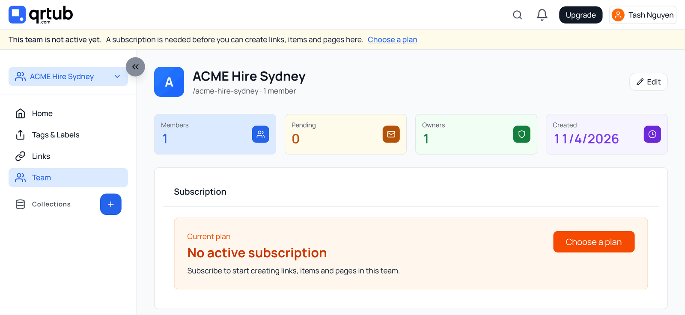

Open the team switcher at the top of the left sidebar and choose **Create Team**. Fill in the
**Create New Team** form, click **Create Team**, and QRtub switches you into the new team and opens
its Team page.

You already have one team without doing this: signing up creates a team named after your email
address, with you as its owner. Create a second one when you genuinely need separate data — a
different business entity, a client whose Items must not mix with yours, or a separate
subscription.

## The form

| Field | What it does |
|-------|--------------|
| **Team Name** | Required. What you and your members see in the switcher and page headers. Change it later at any time. |
| **Team Slug** | Required. Filled in automatically from the name — lowercased, spaces turned into hyphens. You can overwrite it; once you type in it, it stops following the name. |
| **Team logo** | Optional. Shown in the switcher and on the Team page. |

The slug accepts lowercase letters, numbers and hyphens only. Anything else is rejected with
"Slug can only contain lowercase letters, numbers, and hyphens".

Slugs are unique across all of QRtub, not just your teams, so a common one may be taken by someone
you will never meet. If it is, you get "That team slug is already taken" and nothing is created —
add a word and try again. The slug is an identifier, not an address: it is not part of any Link
URL or dashboard address. See [Team Settings](/team/team-settings).

A logo must be a JPG, PNG, GIF or WebP file up to 2 MB. SVG files are rejected. A file that does not
qualify is refused as soon as you pick it, with a message under the field.

**Leave the logo empty for now.** The logo is uploaded after the team is created, and a new team has
no subscription yet, so the upload is refused with *Subscribe to start creating links, items and
pages in this team.* The team itself has been created, but the form stays open and you are not
switched to it: close the form, reload the page and pick the team from the switcher. Add the logo
from [Team Settings](/team/team-settings) once the team is subscribed.

## What you get

You become the team's owner immediately, with every owner-only power in it: settings, invitations,
member removal, and the Subscription section. Nothing else carries over from your other teams.

A new team starts genuinely empty — no Collections, no Items, no Links, no reserved numbered
patterns, no print batches.

Billing is per team. A new team has no subscription of its own, and the plan on your existing team
does not extend to it. Until it has one, the team is read-only: a banner reads *This team is not
active yet.*, nothing can be created or changed there (the team's own name and logo included), and
nobody can be invited. Choose a plan from the **Subscription** section of the Team page, where QRtub has
already put you (see [Upgrading a Team's Plan](/billing/upgrade-a-team)). After that, your first
step is normally [creating a Collection](/collections/creating-a-collection).

## Related

- [Team Overview](/team/overview)
- [Team Settings](/team/team-settings)
- [Switching Between Teams](/team/switching-teams)
- [Creating a Collection](/collections/creating-a-collection)
