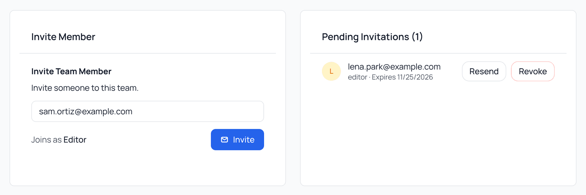

On the **Team** page, use the **Invite Member** card: type the person's email address and click
**Invite**. Only the team's owner sees that card, and the server refuses invitations from anyone else.

Inviting needs an active subscription, and every invitation takes one of your plan's editor seats
as soon as it is sent, before the person accepts. Your own membership takes a seat too, so a plan
with one seat cannot invite anyone. See [Plan Limits & Quotas](/billing/plan-limits). When the
seats are nearly or fully used, a note on the card says so, for example *All 1 editor seat in use.
Upgrade, or remove a member or a pending invitation.*

## The email field

Type the full email address. The dropdown that appears under the field matches **exact addresses
only** — typing `jo` will never suggest `joanne@example.com`. That is deliberate: partial matching
would let anyone probe which email addresses have QRtub accounts. People already on the team are
left out of the suggestions entirely.

You do not have to wait for a suggestion. Type the whole address and click **Invite** either way.

There is no role to choose. The card reads **Joins as Editor**, and everyone you invite joins as an
Editor. A team has one owner, and ownership only changes hands when the owner leaves. See
[Team Roles](/team/roles).

## What happens next depends on the invitee

**If they already have a QRtub account,** a pending membership is created. They appear in your
members table immediately with the status **Pending**, and they get an email plus a notification in
the bell at the top right of their dashboard. They join when they accept it there. This kind of
invitation does not expire.

**If they don't have an account,** QRtub creates an email invitation instead. It appears in the
**Pending Invitations** card, expires in 7 days, and the email they receive contains a link that
creates their account. They join the team automatically on their first sign-in — no accept step.
See [Accepting a Team Invitation](/team/accept-invitation).

The two lists are separate, and this trips people up: someone who already had an account shows up
in the **members table** as Pending, not in the Pending Invitations card. The **Pending** tile at
the top of the page counts email invitations only, and only ones that have not expired.

## When an invitation is refused

- **"This user is already a member of this team."** They are already on the team, or already have a
  pending membership. Check the members table for their row.
- **An email invitation already exists for that address.** QRtub sends the invitation again and
  restarts its 7-day window rather than creating a duplicate. This also works for one that has
  expired and dropped off the Pending Invitations card, as long as a seat is free.
- **"This team has used every editor seat its plan includes. Upgrade, or remove a member first."**
  Every seat is taken, counting people still to accept. Remove a member, revoke an invitation, or
  move to a larger plan.
- **"Subscribe to start creating links, items and pages in this team."** (or *This team is
  read-only…* for a team whose subscription has ended) The team has no active subscription, so
  nothing can be sent until the owner subscribes.
- **"Too many requests. Please try again later."** Each team can send **50 invitations per day**.
  The count is per team, not per person, and it covers both kinds of invitation. Try again later.

## Related

- [Managing Pending Invitations](/team/pending-invitations)
- [Accepting a Team Invitation](/team/accept-invitation)
- [Team Roles](/team/roles)
- [Removing Team Members](/team/remove-members)
