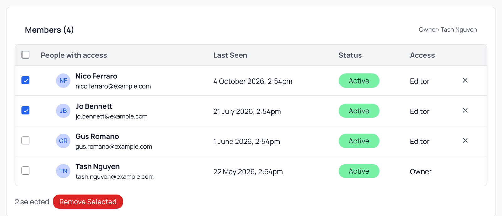

On the **Team** page, find the person in the members table and click the **X** at the right of their
row. Confirm, and they are off the team.

To remove several people at once, tick the checkbox at the left of each row, then use **Remove
Selected** below the table. The checkbox in the header row selects everyone.

Only the team's owner can remove members. Other members see the table without the X or the bulk
button, and the removal is refused at the server too, so there is no way around it.

## Be careful with the owner's own row

The owner's row has no **X**. Its checkbox is still selectable, though — and the header checkbox that
selects everyone includes it.

QRtub refuses to remove the team's owner. If the owner's row is in your selection, the whole
**Remove Selected** is refused with *Transfer ownership before removing the owner from the team.*
and nobody is removed, not even the other people you ticked. Untick the owner's row and try again.

An owner who wants to hand the team over should use **Leave Team** in the Danger Zone instead, which
transfers ownership on the way out — see [Leaving a Team](/team/leave-a-team).

## What removal actually does

Access ends immediately: the team's Collections, Items, Links, Pages, Batches and Tags are no
longer reachable by them, and the team drops out of their team switcher the next time their
dashboard loads.

**Nothing they made is deleted.** Everything in QRtub belongs to the team, not to the person who
created it, so the Items they added, the Links they generated and the Pages they built all stay
exactly where they are. Removing someone is never a way to clean up data.

Their QRtub account itself is untouched, along with any other teams they belong to. If your team was
their only one, they will see "No team selected" and can create a team of their own.

Removing someone frees the editor seat they held, so you can invite someone else in their place.

## Removing a pending member

A row with the status **Pending** is someone who was invited but has not accepted yet. Removing that
row cancels the invitation and frees its seat. They keep no access, and the invitation disappears
from their bell.

That only applies to people who already had a QRtub account. An invitation sent to an address with no
account is not in this table at all — cancel those with **Revoke** in the Pending Invitations card.
See [Managing Pending Invitations](/team/pending-invitations).

## Adding someone back

There is no undo and no archive of past members. To bring someone back, invite them again from the
**Invite Member** card; they will need to accept the new invitation, and they rejoin as an Editor.

## Related

- [Inviting Team Members](/team/invite-members)
- [Managing Pending Invitations](/team/pending-invitations)
- [Leaving a Team](/team/leave-a-team)
- [Team Roles](/team/roles)
