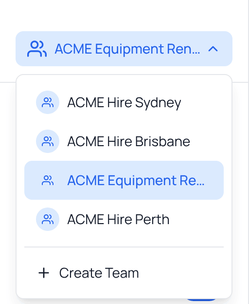

Switch teams from the **team switcher** at the very top of the left sidebar — the button showing
your current team's logo and name. Click it, pick a team from the list, and QRtub reloads
everything for that team.

Picking a different team returns you to the dashboard home first. That is deliberate: the
Collection, Item or batch you were looking at belongs to the team you just left, so there is
nothing to show it in the new one.

## What switching changes

Everything in the dashboard is scoped to the current team. After a switch, the Collections in the
sidebar, the Items inside them, the Links pool, print batches, Tags, reserved numbered patterns
and search results are all the new team's. Your account, your profile and your password are not
team-scoped and do not change.

The team's own settings follow too — the Team page now shows the new team's members, and if you
are its owner, its Subscription section.

## Which teams appear in the list

Only teams where you have an accepted, active membership. Three consequences worth knowing:

- **A team that has invited you does not appear until you accept.** If someone says they added
  you and the team is not in your switcher, the invitation is still waiting in the notification
  bell — see [Accepting a Team Invitation](/team/accept-invitation).
- **A team you left disappears immediately; one you were removed from disappears the next time
  your dashboard loads.** If it was your current team, QRtub quietly moves you to another one.
- **If you belong to no teams at all**, the Team, Items, Links and Tags & Labels pages show
  **No team selected** with "Choose a team from the sidebar, or create one."

## Why you sometimes land in a different team

Your current team is remembered in the browser you are using, not on your account. Sign in from a
different browser, a different device, or a private window, and QRtub has nothing remembered — it
opens the most recently created team you belong to.

So the same account can sit in team A on your laptop and team B on your phone. If something is
missing, check the switcher before anything else: it is far more often the wrong team than missing
data. This also means clearing your browser data resets which team you open in.

## Other places teams are listed

**Create Team** sits at the bottom of the switcher dropdown. When the sidebar is collapsed, the
switcher shrinks to the team logo alone (a people icon for a team without one) — hover it to see
the team name.

Your **Profile** page also lists every team you belong to, and separately lists the teams you own
alongside their subscription status, with a **Manage** or **Subscribe** button that switches to that
team and opens its Team page.

## Related

- [Team Overview](/team/overview)
- [Creating a Team](/team/create-a-team)
- [Accepting a Team Invitation](/team/accept-invitation)
- [Leaving a Team](/team/leave-a-team)
